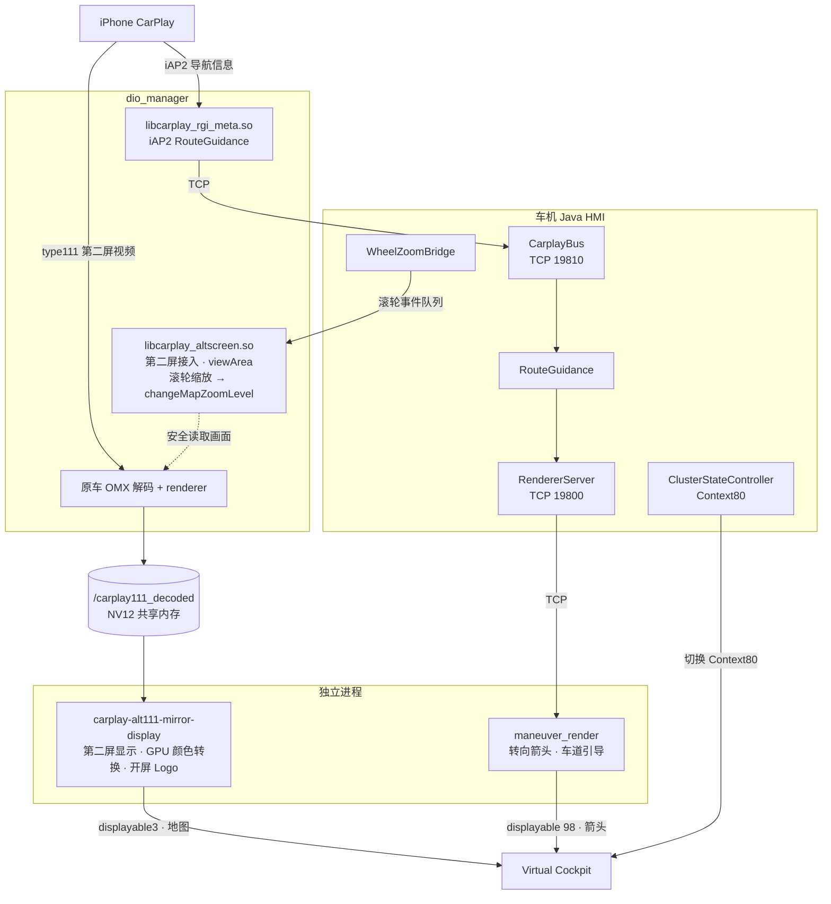

# MIB2 Toolbox — CarPlay AltScreen V3.8 Fix1

[English](README_EN.md) | **简体中文**

本项目面向 Audi **MHI2Q** 平台，用于将 **CarPlay 原生 AltScreen / 第二屏导航画面**直接显示至车辆的 **Virtual Cockpit**。核心显示链路已完成实车验证。操作前请完整阅读本说明。

**V3.8 Fix1 更新（修了这些现象，说人话版）：**
- **CarPlay 来电时在仪表或方向盘上按"接听"，接通一两秒后电话自己挂断**——现在接通后一直保持，直到你自己挂断。（已实车验证）
- **仪表电话页"最近通话"里的时间比手机慢 8 小时**——现在显示车机本地时间，和手机一致。
- **大地图和小地图互相切换时，仪表会先露出"半张画面"**——现在切换时先黑一下、等新画面到位再淡入，看不到残缺画面了。
- **转向箭头出现和消失时跳动生硬**——现在改成淡入淡出，过渡更顺。
- **奥迪 Q7 上只用 CarPlay 导航时，仪表不显示转向箭头**——现在也能正常显示箭头了。
- **导航时仪表上会多出灰色方块/底板**——现在去掉了，只留转向箭头。
- **用电脑（尤其 Mac）拷贝过 SD 卡里的文件夹后，安装或恢复会失败**——现在已兼容，不再中途报错。
- 绿色菜单的抬头版本号更新为 "V3.8 Fix1"。

> [!TIP]
> 插着本项目的 SD 卡开机时，原车会把这张卡当成"媒体"音源恢复，但卡里没有能播放的歌，所以刚连上 CarPlay、手机还没放声音的那段时间，调音量会提示不可用；手机一放音乐就恢复。这是原车的音源逻辑，不是故障。装好以后平时用车可以把卡拔掉，只在需要抓日志时插上。

**V3.8 更新：仪表电话页支持 CarPlay 通话（移植自 [Luka 的 mib2q-carplay-rgi](https://github.com/luka-dev/mib2q-carplay-rgi) 的 CarPlay Telephony）；仪表底部信息栏在路名后显示预计到达时间；新增手机转向卡片安装模式；修复首次连接时仪表第二屏不出画面；本项目原创部分改为禁止售卖的非商用许可。**

**V3.7 更新：完整 RGI 导航信息联动上线（基于 [Luka 的 mib2q-carplay-rgi](https://github.com/luka-dev/mib2q-carplay-rgi) 构建）；第二屏颜色转换改由 GPU 完成，整机 CPU 占用率从约 80% 降至约 20%；运行水印已移除；V3.7 起全部以 GPL-3.0 开源。**

**无线 CarPlay：实测君用 M2Pro 无线盒子（最新内测固件）已完美支持仪表第二屏、RGI、方向盘滚轮缩放和 CarPlay 投屏。**

**V3.7Fix6 更新：修复 LTE 数据连接建立后仪表第二屏无画面。原车此时改用 `pf.ecm0.conf` 等按上网方式区分的防火墙配置，安装时把 6031 放行规则一并写入这些配置。**

**V3.7Fix5 更新：第二屏数据端口固定为 6031 并写入车机防火墙配置，修复冷启动仪表黑屏和 LTE 换 IP 时仪表断流；冷启动时等原车仪表地图加载完成后再显示第二屏；修复 RGI 车道引导中途消失；开屏视频更新为 1:1 铺满仪表；绿色菜单精简为三项，开机日志自动保存到 SD 卡。**

> [!CAUTION]
> **免责声明**
>
> - 本项目的所有改动都会写入并影响车机系统文件。安装、更新、启动、恢复等操作都会修改原车程序、配置和防火墙规则，可能影响车机的正常运行。
> - 本项目免费提供，按"现状"发布，不提供任何形式的担保（见 PolyForm Noncommercial 1.0.0 的 No Liability 条款和 GPL-3.0 第 15、16 条）。
> - **使用本项目即表示你已了解上述风险，并自行承担全部后果。因使用、安装、恢复或修改本项目而出现的任何问题，包括但不限于车机故障、功能异常、无法启动、数据丢失、保修失效以及其他直接或间接损失，作者及贡献者均不承担任何责任。**
> - 如不同意以上条款，请不要安装或使用本项目。

> [!CAUTION]
> **严正声明：强烈谴责 VWODIS（一车网）抹去作者署名与许可、搬运本项目引流**
>
> VWODIS（一车网，QQ：**296520384**）于 10 月 13 日把本项目以「【软件】奥迪 MHI2Q-CARPLAY-Altscreen 原生第二屏导航激活软件 V3.7」为名发布在其网站上（[en.vwodis.com/20912.html](https://en.vwodis.com/20912.html)），标价 **$200**（通用用户组）或 2000 积分（"中士"等级），登录后才能下载。该页面：
>
> - 没有注明原作者，也没有给出本项目的 GitHub 地址；
> - 没有附带 GPL-3.0 许可证，也没有提供源码获取方式；
> - 介绍内容取自本项目 README。
>
> GPL-3.0 允许收费分发，但再分发者必须保留原作者的版权与许可声明，并向下载者提供完整源码（第 4、6 条）；违反许可进行分发的，依本许可获得的全部权利自动终止（第 8 条）。作者联系对方时，对方承认由其发布，却回复「没有不公开源码，没有加密啊」「吸引流量而已」「跟你有什么关系？」「那你不发布不就好了」。
>
> **我们强烈谴责这种拿开源作者的劳动成果为自己引流、抹去作者署名与许可的行为，并要求对方立即改正或下架。**
>
> **本项目只在 GitHub（[yuedizhibo/MHI2Q-CarPlay-AltScreen](https://github.com/yuedizhibo/MHI2Q-CarPlay-AltScreen)）免费发布，任何收费、积分或会员下载渠道都与作者无关。** 第三方渠道的文件可能被修改或混入旧版文件，请只从本仓库的 Release 下载。

<details>
<summary>证据截图：对方页面、标价与聊天记录（点击展开）</summary>


</details>

> [!NOTE]
> **姊妹项目：MMI Mirror**  
> 如果你希望显示的是 **MMI 中控完整画面镜像**，而不是 CarPlay 原生第二屏，请前往：  
> **[MHI2Q-CarPlay-MMI-Mirror](https://github.com/Lanye-z/MHI2Q-CarPlay-MMI-Mirror)**

> [!TIP]
> **交流群**  
> 欢迎加入交流群，讨论安装使用、反馈问题、分享实车测试结果：  
> - QQ 群：**823297190**  
> - Telegram：[https://t.me/+xZ2pabi2nmk1MDI9](https://t.me/+xZ2pabi2nmk1MDI9)

> [!WARNING]
> **⚠️ 写在前面**
>
> 考虑到此前免费测试成果曾被未经允许包装和倒卖，本项目早期版本只公开了运行包，并分阶段发布功能。**自 V3.7 起，本项目全部开源**：全部功能与源码均已在本仓库公开。
>
> **自 V3.8 起，本项目原创部分禁止售卖。** 第二屏 hook、显示进程、安装脚本、绿色菜单和说明文档改为 **PolyForm Noncommercial 1.0.0 + [附加条款](Toolbox/carplay_alt_screen/LICENSE.ADDITIONAL-TERMS.md)**：个人可以免费使用、研究、修改和免费转发；不得出售或收费分发；收费帮人安装的，每台车每次的费用总额不得超过人民币 100 元。基于 Luka / Allemon 的 Java HMI 与 RGI 部分继续按 GPL-3.0 发布。详见文末「许可、作者与第三方文件」。
>
> 当前版本并非演示代码，现有 CarPlay AltScreen 第二屏功能已经可以正常实车使用。
>
> 本项目最初就是基于我们自己的车辆和日常使用需求进行开发。**中国区（CN）AUG22 固件已经过实车测试，可以正常使用。** 部分欧洲区（ER）AUG22 固件已有用户实车反馈可以使用（如 `MHI2Q_ER_AUG22_P5092` / `P5152`，MU 1329）。**美版（US）AUG22 固件 `MHI2Q_US_AUG22_P4246`，MU 1320 已实车测试（2018 款奥迪 Q5，北美，V3.8）— 见 [docs/vehicle-tests](docs/vehicle-tests/2018-audi-q5-us-aug22-p4246.md)。** 其他 ER / US 版本及其他地区固件可能存在未知 BUG，**不保证 100% 可用**，请自行评估风险并保留好原车备份。本项目不支持 MHI2 平台；请不要绕过安装脚本的固件检查强制安装。
>
> **免费分享。** 本项目的源码和安装包都可以在 GitHub 上免费获取，请不要花钱购买。
>
> 欢迎学习、研究和交流。如果有人向你出售本项目，或帮你安装时收费超过人民币 100 元，请通过 Issue 反馈。

> [!IMPORTANT]
> 本项目会修改车机系统文件。安装、启动或恢复过程中请保持 SD 卡连接和车机供电稳定。  
> **安装或恢复完成后，请按照页面中的步骤完整重启车机 / HMI，再判断结果。**
>
> 请勿在驾驶过程中进行安装、更新、恢复或故障处理。

---

## 实车效果


---

## 当前公开版本已支持

- CarPlay 原生 AltScreen
- CarPlay 主屏正常使用，不受第二屏影响
- 无线 CarPlay：君用 M2Pro 无线盒子（最新内测固件）实测支持第二屏、RGI、滚轮缩放和投屏
- 完整 RGI 导航信息联动（基于 [Luka 的 mib2q-carplay-rgi](https://github.com/luka-dev/mib2q-carplay-rgi) 构建）
  - 仪表转向箭头与车道引导
  - 可在安装时选择是否启用（`INSTALL WITH RGI` / `INSTALL WITH RGI CARD` 启用；`INSTALL WITH NOTHING` / `INSTALL WITH CARD` 不显示转向箭头）
- 仪表电话页显示 CarPlay 通话（**移植自 [Luka 的 mib2q-carplay-rgi](https://github.com/luka-dev/mib2q-carplay-rgi) 的 CarPlay Telephony**）
  - 原车连接 CarPlay 时电话页只显示"iPhone 处于 Apple CarPlay 模式"提示，现在像蓝牙电话一样显示来电、拨号、通话、保持状态，以及来电名字、号码和通话计时
  - 在仪表和方向盘上接听、挂断、保持 / 恢复、两路通话切换、麦克风静音
  - 最近通话（iPhone 最多提供 12 条）和个人收藏，可直接拨出；未接来电提示、信号格和运营商
  - 中控按 TEL 键直接进入 CarPlay 电话，跳过"iPhone 处于 Apple CarPlay 模式"弹窗
  - CarPlay 不向车机提供通讯录和来电头像：仪表"通讯录"显示无电话簿
  - 所有安装模式都启用；连接蓝牙电话时完全走原车
- 仪表底部信息栏在路名后显示预计到达时间，例如"中山路 | 14:35"；所有安装模式都有，导航软件已带到达时间时不会重复显示
- 手机转向卡片（`INSTALL WITH CARD` / `INSTALL WITH RGI CARD`）：iPhone 在仪表地图旁显示转向提示卡片，位置用绿色菜单 `CARD LEFT` / `CARD TOP` / `CARD RIGHT` 选择；目前只有 B9（A4/A5 等）和 Q7 布局的大地图视图显示卡片
- Classic / Sport 动态布局适配
- 全域居中
- 方向盘左侧滚轮缩放
- 仪表地图显示限速牌和指南针，地图画面上不叠加 ETA（到达时间显示在底部信息栏）
- GPU 颜色转换：整机 CPU 占用率从约 80% 降至约 20%
- 冷启动等待原车仪表地图就绪后再显示第二屏
- 第二屏固定端口防火墙放行，LTE 换 IP 不断流
- 安全安装与恢复
- 安装 / 恢复中断保护
- 原车配置恢复
- 开机日志自动保存到 SD 卡，原车备份保存在 SD 卡

## 适用范围

| 项目 | 状态 |
|---|---|
| 平台 | 仅 **MHI2Q**；不支持 MHI2 |
| 固件版本 | **AUG22**；安装脚本会核验车机固件版本，非 AUG22 会拒绝安装 |
| 中国区（CN）固件 | ✅ 已实车测试，可以正常使用 |
| 欧洲区（ER）部分固件 | ✅ 用户实车反馈可用（如 `MHI2Q_ER_AUG22_P5092` / `P5152`，MU 1329） |
| 美版（US）固件 | ✅ 已实车测试：`MHI2Q_US_AUG22_P4246`，MU 1320（2018 款奥迪 Q5，北美，V3.8）— 见 [docs/vehicle-tests](docs/vehicle-tests/2018-audi-q5-us-aug22-p4246.md) |
| 其他 ER / US 版本及其他地区固件 | ⚠️ 可能存在未知 BUG，不保证 100% 可用 |
| 无线 CarPlay 盒子 | ✅ 君用 **M2Pro**（最新内测固件）实测完美支持：仪表第二屏、RGI、方向盘滚轮缩放、CarPlay 投屏 |
| iPhone 系统版本 | ✅ 推荐 **iOS 26**；⚠️ 低于 iOS 18 时，百度地图可能不支持仪表第二屏，高德地图可能出现画面比例异常 |

> [!TIP]
> 本项目主要在 **iOS 26** 上完成适配和测试。如果仪表上看不到百度地图画面，或高德地图比例不正常，请先把 iPhone 升级到 iOS 18 或更高版本（推荐 iOS 26）再排查。

---

## 工作原理与架构

本项目不再依赖早期的 Window58 读取路线，而是直接接入 CarPlay 的 **private type111** 第二屏视频流：保留原车 AirPlay / OMX 解码流程，从原车 renderer 安全读取画面并线性化为标准 NV12，再交给独立显示进程，最终通过 GLES / displayable3 / Java Context80 输出到仪表。完整 RGI 则通过 iAP2 RouteGuidance 取得导航信息，由 Java HMI 转发给独立的转向箭头渲染器。

### 架构图



### 第二屏显示链路

```text
iPhone CarPlay
  ↓
private type111 第二屏视频流
  ↓
原车 AirPlay / OMX 解码
  ↓
QNX Screen 读取 + 线性化 → 标准 NV12（/carplay111_decoded）
  ↓
独立显示进程（carplay-alt111-mirror-display）
  ↓
GPU 着色器完成 NV12 → RGBA 颜色转换
  ↓
GLES / displayable3（1440×542 源画面 1:1 输出到 1440×455 仪表平面）
  ↓
Java/HMI Context80
  ↓
Virtual Cockpit
```

- CarPlay 主屏（Main110）保持原车链路，不参与这条显示路径。
- 不引入额外解码器，继续复用 MHI2Q 上已经稳定工作的原车解码流程，减少新变量。
- FULL / SMALL 两个 viewArea 通过标准 `updateViewArea` 在同一 CarPlay 会话中动态切换；Classic / Sport 布局跟随车机 HMI 状态。
- Java/HMI 是 Context80 的唯一控制方，显示进程不直接修改仪表 Context。
- 第二屏数据走固定端口 TCP 6031：安装时在车机 `pf.conf` 以及按上网方式区分的 `pf.ecm0.conf`、`pf.ppp0.conf`、`pf.mlan0.conf` 中，于 carplay0 阻断规则之前写入一条放行规则，开机随原车防火墙配置一起加载，建立第二屏时不再临时执行 `pfctl`。原车因 LTE 换 IP 重新加载防火墙配置，或 LTE 数据连接建立后改用 `pf.ecm0.conf` 等配置时，这条规则也会一起加载。这几份配置要么全部写入，要么全部不写；规则未写入或端口被占用时，自动退回随机端口加运行时放行规则。

### 冷启动：等待原车仪表地图

冷启动时，Java HMI 每 500 ms 在原车导航线程上检查一次仪表地图（MapKombi）是否已初始化。初始化完成后，通过本机总线（TCP 19810，命令 `0x0119`）通知 `libcarplay_rgi_meta.so`，再转交给 `libcarplay_altscreen.so`。收到通知之前，hook 不会向 iPhone 请求第二屏画面（`showUI` / `forceKeyFrame`）、不切换 viewArea，显示进程也不会启动，所以开屏视频和第二屏画面都要等原车地图就绪后才出现。CarPlay 主屏、第二屏能力声明和 iPhone 建立第二屏视频流不受影响。

这里等待的是原车仪表地图对象初始化完成，不是 GPS 定位，也不是开始导航。就绪状态只在内存中记录，之后原车地图隐藏也不会重新关闭。这一步没有超时：原车仪表地图没有起来时，第二屏一直等待。

### 性能优化：GPU 颜色转换

早期版本中，解码后的 NV12 画面由显示进程在 CPU 上逐帧转换为 RGBA，再上传给 GPU 显示，车机负载较大。V3.7 把 NV12 → RGBA 颜色转换移到 GPU：显示进程把 Y 平面和 UV 平面分别作为纹理上传，由 GLES 片段着色器完成颜色转换，CPU 不再逐像素处理，也不再分配 RGBA 中间缓冲。

实车测试中，**整机 CPU 占用率从约 80% 降至约 20%**。

### RGI 导航信息链路

- `libcarplay_rgi_meta.so` 在原车 CarPlay 进程中接收 iAP2 RouteGuidance 导航信息，通过本机 TCP 19810 交给 Java HMI。所有安装模式都会加载它并启动这条本机总线，原车地图就绪通知也经由它传递。不带 RGI 的 `INSTALL WITH NOTHING` / `INSTALL WITH CARD` 同样接收导航信息，但只用于底部信息栏的路名和到达时间，不启动转向箭头渲染器。
- 转向箭头和车道引导通过本机 TCP 19800 发给独立的 `maneuver_render` 进程，由它绘制到 displayable 98；该进程由 `rgi_supervisor.sh` 守护，异常退出后有限次自动重启。

### 底部信息栏：路名与到达时间

导航时，Java HMI 把路名和预计到达时间写入仪表底部信息栏（BAP FctID 19），格式为"路名 | 到达时间"。导航软件发来的文字里已经带了到达时间时只保留一份。`INSTALL WITH RGI` / `WITH RGI CARD` 同时接管转向箭头、距离和剩余时间等导航信息；`INSTALL WITH NOTHING` / `WITH CARD` 只写这一行文字，其余信息保持原车行为。

### 手机转向卡片

`INSTALL WITH CARD` / `WITH RGI CARD` 时，hook 向 iPhone 声明带转向卡片的仪表布局并加宽大地图区域，iPhone 直接在第二屏画面中画出转向卡片。`CARD LEFT` / `CARD TOP` / `CARD RIGHT` 把位置写入车机，hook 每 100 ms 读取一次，CarPlay 连接时在大地图视图中立即生效，不需要重连；重新 INSTALL 后恢复为默认的 TOP。小地图视图和 B9、Q7 以外的布局没有放卡片的空间，只显示地图。

### 仪表电话页链路

本功能移植自 [Luka 的 mib2q-carplay-rgi](https://github.com/luka-dev/mib2q-carplay-rgi) 的 CarPlay Telephony（原理见其 `docs/cluster-and-rgi/CARPLAY_TELEPHONY.md`），按本项目的单一 HMI JAR 结构做了适配。

- 原车在 CarPlay 连接期间通过 BAP 告诉仪表"手机处于 Apple CarPlay 模式"，仪表电话页因此只显示提示。Java HMI 包装原车的仪表电话服务：只在原车自己判定 CarPlay 已连接时，改为向仪表报告免提电话，并填入 CarPlay 的通话、列表和信号；CarPlay 断开后重放原车的值。连接蓝牙电话时全部原样交给原车。
- 通话状态取自原车终端模式事件总线（原车本来就把 DSICarplay 的通话状态转发到这里），拨号也走原车 CarPlay 的 `tel:` 拨号。本项目没有像 Luka 那样整体替换 `CarplayDSILifecycleController`（Luka 为中国区单独维护了一份该类的补丁），而是只用公开接口和运行时包装，这样一个 HMI JAR 即可通用于 US（MU1316）、EU（MU1329）和 CN（MU1003）。
- 按一次方向盘电话键，CarPlay 会收到两份：仪表经 BAP 发出的接听 / 挂断（本项目转成 iAP2），以及原车 MFL 电话键发给 iPhone 的 HID 按键。在 HID 生效的车上，第二份会把刚接通的电话挂掉。Java HMI 在运行时包装原车 `DSISmartphoneManagerProxy` 的电话控制器，只在仪表电话页显示 CarPlay 通话且有通话时丢弃原车这一份（hook / hangup / flash），其他按键和原车其他挂断路径不受影响；与 Luka 在 `postDSICarplayButtonEvent` 处的改法等效，但不替换任何原车类。原车每次切换设备时会重写这个控制器，所以 CarPlay 激活时和每次通话状态更新时都会重新挂上；包装不上时什么也不做，原车行为不变。
- 最近通话的时间由 iPhone 以 UTC 时间戳发来，按车机自己的时区和夏令时换算后显示，与车机时钟和底部到达时间一致。
- `libcarplay_rgi_meta.so` 中的电话模块通过 iAP2 订阅最近通话和个人收藏，只读原车已订阅的信号、运营商和电量信息，并把接听、挂断、切换、保持、静音命令发给 iPhone，与 Java 之间同样走本机 TCP 19810。安装时在 `dio_manager.json` 中登记这 7 个 iAP2 消息号（`0x415B`–`0x415D`、`0x415F`、`0x4160`、`0x4170`、`0x4171`），复原时随原车备份还原。
- 为此替换了三个原车类：`ServiceManagerPhone`、电话与系统状态机的 `Activator`。它们在三版固件中逐字节相同；如果本项目的电话类无法加载，会自动退回原车对象，不影响原车电话和整个 HMI 启动。

### 方向盘滚轮缩放

Java HMI 捕获方向盘左侧滚轮事件，写入事件队列；`libcarplay_altscreen.so` 按目标缩放级别逐步向 iPhone 发送标准 `changeMapZoomLevel` 请求，并根据第二屏新帧控制发送节奏。

---

## 源码结构与构建

V3.7 起全部源码都在本仓库中：

| 路径 | 内容 | 产物 |
|---|---|---|
| `Toolbox/carplay_alt_screen/src/` | 原车 CarPlay 进程的预加载 hook：private111 第二屏接入、画面读取、viewArea、滚轮缩放 | `universal/libcarplay_altscreen.so` |
| `Toolbox/carplay_alt_screen/mirror_display/` | 第二屏显示进程（C++ / GLES / displayable3），GPU 完成颜色转换，内嵌开屏 Logo | `mirror_display/release/carplay-alt111-mirror-display` |
| `Toolbox/carplay_alt_screen/rgi_native/` | RGI 预加载 hook：iAP2 RouteGuidance 解析与转发、原车地图就绪通知转发；`telephony/` 为仪表电话页的 iAP2 模块（移植自 Luka 的 mib2q-carplay-rgi） | `rgi_meta/libcarplay_rgi_meta.so` |
| `Toolbox/carplay_alt_screen/rgi_renderer/` | 转向箭头 / 车道引导渲染器 | `rgi_renderer/release/maneuver_render` |
| `Toolbox/carplay_alt_screen/hmi/` | Java HMI hook：Context80、仪表图层、RGI 分发、滚轮事件、原车地图启动等待；`src/com/luka/carplay/telephony/` 与 `src/de/audi/` 下替换的原车类为仪表电话页（移植自 Luka 的 mib2q-carplay-rgi）；`stubs/` 为编译用原车接口桩，`vendor/` 为基线 JAR，其中不由 `src/` 编译的类的源码放在 `vendor/src/`，逐个类的说明见 `vendor/SOURCES.md` | `hmi/carplay_hook-basevideo3.jar` |
| `Toolbox/scripts/`、`Toolbox/GEM/` | 安装 / 启动 / 状态 / 恢复 / 诊断脚本与绿色菜单 | 随 SD 卡使用 |
| `Tools/`、`BUILD-*.sh` | 构建与校验工具 | — |

构建需要 QNX 6.5.0 SDP 的 ARM 交叉工具链（`arm-unknown-nto-qnx6.5.0eabi-gcc`）：

```sh
sh BUILD-UNIVERSAL-QNX.sh      # 第二屏 hook → libcarplay_altscreen.so
sh BUILD-MIRROR-QNX.sh         # 第二屏显示进程 → carplay-alt111-mirror-display
bash Tools/build_rgi_qnx.sh    # RGI hook + 渲染器 → libcarplay_rgi_meta.so、maneuver_render
```

构建输出位于 `dev-build/` 或 `mirror_display/build/` 目录（不纳入版本库），不会直接覆盖 `release/` 中的上车文件。替换上车文件后，请同步更新对应的 `BUILD_INFO.txt`、`SHA256SUMS` 与根目录的 `SHA256SUMS-SD.txt`。

---

## 安装与测试

> [!IMPORTANT]
> **本仓库现在只提供 CarPlay AltScreen 覆盖包，不再包含完整 MIB2 Toolbox 安装器。**
>
> - **红色软件更新菜单**只用于安装 / 修复上游 [jilleb/mib2-toolbox](https://github.com/jilleb/mib2-toolbox)。
> - **本项目本身不能直接通过红色菜单安装。**
> - 本项目应在上游 Toolbox 已正常安装后，通过绿色菜单里的 **`MQBCoding → Update Toolbox`** 写入菜单和脚本。
> - 如果绿色菜单里的 `Update Toolbox` 提示 `Script not found` 或缺少 `/eso/hmi/engdefs/scripts/mqb/update_toolbox.sh`，先重新安装 / 修复上游 Toolbox，再继续本项目。
> - **从本项目旧版本升级时无需手动复原**：安装程序会先自动卸载旧版，再安装新版，详见第 8 节。

### 1. 先确认上游 MIB2 Toolbox 是否正常

1. 先在车机信息页确认固件版本为 **AUG22**。安装脚本会核验固件版本，非 AUG22 固件会被拒绝；版本不符或无法确认时停止操作，不要绕过检查。非中国区固件请先阅读上方「适用范围」。
2. 车辆停稳并保持稳定供电。备份正在使用的 SD 卡及原车文件，准备一张可正常读写的 **FAT32** SD 卡。如果旧卡已有 `MMI-Cockpit-Carplay` 目录，换卡时完整保留；其中有原车备份，日后恢复需要这张备份卡。
3. 如果车上已经能够正常进入 `Green Developer Menu → MQBCoding`，并且 **`Update Toolbox` 可以正常执行且不会提示 Script not found**，可直接跳到第 2 节。
4. 如果车上尚未安装上游 Toolbox，或者绿色菜单存在但 `Update Toolbox` 已损坏 / 提示脚本不存在，请前往 **[jilleb/mib2-toolbox](https://github.com/jilleb/mib2-toolbox)** 下载最新完整版本并解压。将**上游包内的文件和目录**复制到 SD 卡根目录，不要再套一层 ZIP 名称文件夹。
5. 车机中只插这一张 SD 卡，进入红色菜单，选择 `Software updates/versions → Update → SD 卡 → MQB Coding MIB2 Toolbox`。等待软件更新和自动重启全部完成，不要提前拔卡或断电。
6. 重启完成后，进入 `Green Developer Menu → MQBCoding`，确认 **`Update Toolbox` 能正常执行**。如果上游安装包不被识别，检查 FAT32、根目录结构和上游说明；仍被拒绝就停止，不要强制刷入。

### 2. 将本项目覆盖包合并到上游 Toolbox

1. 在电脑上保留**上游完整 MIB2 Toolbox SD 卡内容**，不要删除其 `metainfo2.txt`、`Toolbox/final/`、`Toolbox/GEM/mqb-main.esd`、`Toolbox/scripts/update_toolbox.sh` 或其他上游文件。
2. 从本仓库 [Releases](https://github.com/yuedizhibo/MHI2Q-CarPlay-AltScreen/releases) 下载安装包并解压。这里使用的是已编译的上车覆盖文件，**不需要复制源码或编译目录**。将安装包中的 **`Toolbox/` 目录合并到 SD 卡根目录已有的 `Toolbox/` 目录**：
   - 同名文件：使用本项目版本覆盖；
   - 上游独有文件：全部保留；
   - 从本项目旧版升级时（先按第 8 节完成复原），删除卡上 `Toolbox/carplay_alt_screen/mirror_display/release/` 内旧版的 `logo.rgba` 和 `watermark.rgba`；新版不再使用它们；
   - **不要清空后再复制，也不要把本项目当成一张独立的红菜单安装卡。**
3. 安装包根目录的 `SHA256SUMS-SD.txt` 也一并复制到卡根目录，用于下一步校验。若更换 SD 卡，务必同时完整保留 `MMI-Cockpit-Carplay` 原车备份目录。
4. 正确结构应类似：

```text
SD 卡根目录/
├─ metainfo2.txt                 ← 上游 Toolbox 保留
├─ Toolbox/
│  ├─ final/                     ← 上游 Toolbox 保留
│  ├─ GEM/
│  │  ├─ mqb-main.esd            ← 上游 Toolbox 保留
│  │  └─ mqb-carplayAltScreen.esd← 本项目
│  ├─ scripts/
│  │  ├─ update_toolbox.sh       ← 上游 Toolbox 保留
│  │  └─ ...AltScreen scripts... ← 本项目
│  └─ carplay_alt_screen/        ← 本项目 payload
└─ SHA256SUMS-SD.txt
```

5. 不要出现 `SD卡/Toolbox/`、`MHI2Q-CarPlay-AltScreen/Toolbox/` 之类的额外层级。
6. 在 SD 卡根目录用 Git Bash、Linux 或其他提供 `sha256sum` 的环境运行：

```sh
sha256sum -c SHA256SUMS-SD.txt
```

确认本项目清单中的文件均为 `OK`。该清单只校验本项目覆盖文件，不校验上游完整 Toolbox。

### 3. 用绿色菜单加载本项目菜单和脚本

1. 将合并后的 SD 卡插回车机。
2. 打开 `TESTMODE → Green Developer Menu → MQBCoding`。
3. 执行 **`Update Toolbox`**。此步骤由上游 Toolbox 的更新脚本负责把 SD 卡中的 `Toolbox/scripts/` 和 `Toolbox/GEM/` 同步到车机。
4. 更新完成后退出并重新打开绿色菜单，进入：

```text
Customization
└─ MMI-Cockpit-Carplay
```

   确认菜单顶部显示的版本号与下载的安装包一致（当前为 **`Version: V3.8 Fix1`**），菜单中有 4 个安装选项（`INSTALL WITH NOTHING`、`INSTALL WITH RGI`、`INSTALL WITH CARD`、`INSTALL WITH RGI CARD`）、3 个卡片位置选项（`CARD LEFT`、`CARD TOP`、`CARD RIGHT`）和 `RESTORE ORIGINAL`。如果仍是旧版本号，说明车机里的菜单和脚本还是旧的，此时执行 `INSTALL` 仍会运行旧的安装流程；请重新执行 `Update Toolbox`，确认版本号正确后再继续。

5. 如果此时仍提示：

```text
Script not found:
/eso/hmi/engdefs/scripts/mqb/update_toolbox.sh
```

说明车机上的**上游 Toolbox 基础安装本身仍未修复**。不要继续执行本项目的 `INSTALL`，应返回第 1 节重新修复上游 Toolbox。

### 4. 安装第二屏

安装和启用已经合并为一步，**全程只需重启一次**：

1. **断开 iPhone / CarPlay**，避免安装过程中正在输出导航视频。
2. 在 `MMI-Cockpit-Carplay` 菜单中选择一种安装模式：
   - `INSTALL WITH RGI`（推荐）：第二屏地图 + 完整 RGI（转向箭头、车道引导）+ 底部信息栏的路名和到达时间。
   - `INSTALL WITH RGI CARD`：在 `INSTALL WITH RGI` 的基础上，再显示 iPhone 的转向卡片。
   - `INSTALL WITH CARD`：第二屏地图 + iPhone 转向卡片 + 底部信息栏的路名和到达时间，不显示转向箭头。
   - `INSTALL WITH NOTHING`：第二屏地图 + 底部信息栏的路名和到达时间，不显示转向箭头和卡片；适合只需要地图或排查 RGI 问题时使用。

   转向卡片目前只在 B9（A4/A5 等）和 Q7 布局的大地图视图显示。位置用 `CARD LEFT` / `CARD TOP` / `CARD RIGHT` 选择，默认 TOP，CarPlay 连接时立即生效；重新 INSTALL 后恢复为 TOP。
3. 等待屏幕最后出现 `RESULT:` 结论，期间不要拔卡、断电或重启。安装程序会依次执行 5 步，每一步都会实时显示进度：

   ```text
   [1/5] Checking package and firmware...      检查安装包和固件版本
   [2/5] Checking for a previous installation... 检测旧版本，有则先自动卸载
   [3/5] Installing AltScreen + RGI...          安装（出错自动回滚）
   [4/5] Enabling autostart...                  写入开机自启
   [5/5] Verifying installation...              最终校验
   ```

4. 看到 `RESULT: SUCCESS` 后，**完整重启车机一次**，然后连接 iPhone、进入 CarPlay 并启动导航，观察 Virtual Cockpit 是否出现第二屏画面且能随导航更新。冷启动时第二屏要等原车仪表地图加载完成后才会出现，这是正常的。
5. 如果显示 `RESULT: FAILED`，结论下方会写明失败在哪一步、车机当前处于什么状态（未改动 / 已回滚 / 已恢复原车）以及下一步该怎么做，按提示操作即可。完整过程记录在 `Log:` 所示的 SD 卡日志中。

安装模式记录在 SD 卡安装日志（`MMI-Cockpit-Carplay/logs/operations/install_*.log`）的 `INSTALL_RGI_MODE=WITH / NO` 和 `INSTALL_CARD_MODE=WITH / NO` 中。要切换模式，直接用另一种模式重新执行 INSTALL 即可，安装程序会先自动卸载当前版本。

仪表电话页和底部信息栏的到达时间在所有安装模式下都会启用；从旧版本升级后需要重新执行一次 INSTALL 并完整重启，才会写入它们需要的 iAP2 消息号。

> [!NOTE]
> 第二屏启动时会先播放约 5 秒的开屏视频（铺满仪表），然后切换到 CarPlay 画面，属于正常现象。它不是整车开机 Logo。

### 5. 排查

- 判断是否成功以**仪表实际显示画面**为准。
- 若完全看不到 `MMI-Cockpit-Carplay` 菜单，先确认上游绿菜单正常、SD 卡目录层级正确，并确认 `MQBCoding → Update Toolbox` 已成功执行。
- 若 `Update Toolbox` 本身报 `Script not found`，这是上游 Toolbox 基础安装问题，不是本项目第二屏安装脚本的问题；先用上游完整包通过红色软件更新菜单修复 Toolbox。
- 若冷启动后仪表一直没有第二屏，先确认原车导航地图能在仪表上正常显示。本项目要等原车仪表地图初始化完成才会请求第二屏，原车地图起不来时第二屏也不会出现。开机日志 `hook_tmp.log` 中有 `PHASE=OEM_MAP_READY` 表示已放行；只有 `PHASE=ALT111_REQUEST_DEFERRED ... reason=oem_map_not_initialized` 表示仍在等待原车地图。
- 若百度地图在仪表上不显示，或高德地图画面比例异常，先确认 iPhone 系统为 iOS 18 或更高版本（推荐 iOS 26）。
- 若 SD 卡找不到，核对 FAT32、卡根目录文件和读写状态。第二屏没有画面时，先确认已连接 CarPlay 且导航正在输出，再保存日志反馈；不要反复重新安装。

### 6. 日志

- 安装后，每次开机的运行日志会自动保存到 SD 卡的 `MMI-Cockpit-Carplay/logs/boots/boot_*/` 目录（开机时需插着 SD 卡），包括 private111 建连与断开、H.264、Screen 读取、decoded SHM、显示帧率、displayable3、Context80、viewArea 与布局状态、防火墙规则和网络状态，以及原车系统日志。
- 安装、复原等操作的日志保存在 SD 卡的 `MMI-Cockpit-Carplay/logs/operations/` 目录。
- 车机上运行中的日志位于 `/tmp/`，例如 `/tmp/altscreen_hook.log`、RGI 渲染器的 `/tmp/maneuver_render.log`。
- 仪表电话页的日志：Java 侧在 `carplay_hook.log`（`TELEPHONY_BRIDGE`、`TELEPHONY_GATE`、`TELEPHONY_LISTS`、`TELEPHONY_ACTION`、`TELEPHONY_POPUP_SKIP`，以及方向盘电话键过滤的 `TELEPHONY_STOCK_HID_FILTER installed / re-armed / not installed` 和 `TELEPHONY_STOCK_HID_DROPPED`），iAP2 侧在 `carplay_rgi_native.log`（`TELEPHONY_READY`、`TELEPHONY_LISTS_REQUESTED`、`TELEPHONY_CMD`）。两者都会随开机日志保存到 SD 卡的 `streams/` 目录。
- 出现问题时请先保存完整日志，再修改配置或代码。反馈问题时请附上 SD 卡上整个 `MMI-Cockpit-Carplay/logs/` 目录，并说明固件版本与地区、Classic / Sport 和 FULL / SMALL 布局，以及连接方式（先插手机再启动车机 / 车机完全启动后再插手机 / 快速重连）。

### 7. 恢复原车

1. 插入保留了 `MMI-Cockpit-Carplay` 原车备份目录的 SD 卡，在菜单选择 `RESTORE ORIGINAL`。之前开机的日志已经自动保存在 SD 卡上，复原前无需另外导出。
2. 等待屏幕出现 `RESULT:` 结论。`RESULT: SUCCESS` 表示已恢复原车配置，然后完整重启车机。恢复会停止显示进程、释放 Context80 显示需求、移除启动项、删除本项目的 HMI JAR，并还原安装前保存的 HMI 文件和 preload 相关配置。
3. 如果显示 `RESULT: FAILED`，按结论下方的提示操作；若提示 rollback 不完整，**不要重启**，先再次执行 `RESTORE ORIGINAL`。车机本来就是原车状态时会显示 `RESULT: NOTHING TO RESTORE`。

### 7.1 救车模式：用同型号、同固件的备份复原

普通 `RESTORE ORIGINAL` 和 INSTALL 第 2 步的自动卸载会严格检查车机文件与原车备份，文件差异超出本项目的正常改动时会拒绝，避免覆盖其他修改。VIN 不一致只会警告“使用了其他车辆的备份”，不会单凭 VIN 拒绝；普通模式的文件保护仍然有效。

如果车机文件已经损坏，普通复原因文件内容不一致而无法继续，可以手动启用救车模式。**只能使用同型号车机、完整固件版本号完全一致的纯净原车备份**；例如不同地区、不同 train 的备份不能混用，只看 MU 号相同也不够。脚本强制检查备份中记录的固件 train，同型号需要你在借备份前确认。

1. 先完整保存现有 SD 卡、自己的原车备份和日志，放在电脑上另外的目录。不要把这些唯一副本覆盖掉。
2. 使用当前安装包的 Toolbox。在 SD 卡的 `MMI-Cockpit-Carplay/backup/` 下放入匹配的**完整备份目录**，包括 `original`、`firewall-original`、`universal-hook-original` 等原有子目录与校验文件，不要只挑几个 `.so` 或 JSON 文件。
3. 在 SD 卡创建一个空文件 **`MMI-Cockpit-Carplay/RESCUE_RESTORE`**。这是文件，不是目录，文件名没有 `.txt` 扩展名；Windows 中请先显示文件扩展名，确认没有建成 `RESCUE_RESTORE.txt`。
4. 插入 SD 卡，保持稳定供电，断开手机，在绿色菜单选择 **`RESTORE ORIGINAL`**。无需增加绿色菜单选项。屏幕会显示 `RESCUE MODE`；固件版本不一致、版本无法读取、备份缺文件或校验失败时都会拒绝。**没有记录固件版本的旧备份不能用于救车，没有第二个标记可以绕过。**
5. 救车模式允许覆盖内容不同的系统二进制及配置文件，包括 `dio_manager`、`libairplay.so`、`libNmeBaseClasses.so`、两个 CarPlay 配置 JSON、`pf.conf` 以及 `pf.ecm0.conf` 等按上网方式区分的防火墙配置。写回前会保存本车当前状态的独立事务快照，失败时尝试回滚到救车前状态；这份快照不是新的“纯净原车备份”，不会替换借来的或自己的原车备份。此前中断的事务会保留在 `install-transaction/rescue-preserved.*` 或 `restore-transaction/rescue-preserved.*`，不会作为救车写回数据。
6. 等待 **`RESULT: RESCUE SUCCESS`**，保存日志，删除 SD 卡上的 **`MMI-Cockpit-Carplay/RESCUE_RESTORE`**，然后完整重启车机。若失败，按界面提示处理；不要因为留下标记就认为已经复原成功。

这个标记只对手动复原 `RESTORE ORIGINAL` 生效。只要标记还在，之后每次手动复原都会按救车模式执行，所以救车完成后一定要删除它。**INSTALL 的自动卸载始终使用普通严格检查，即使 SD 卡上有救车标记也不会自动覆盖不匹配的文件。** 救车模式只恢复本项目备份覆盖的文件，不能代替完整固件刷写，也不能保证修复其他系统文件损坏。

### 8. 从旧版本升级

升级**不需要再手动复原**：

1. 断开 iPhone / CarPlay，插入保留了 `MMI-Cockpit-Carplay` 原车备份目录的 SD 卡（即当初安装用的卡）。
2. 按第 2 节把新版覆盖包合并到这张 SD 卡，删除旧版遗留的 `logo.rgba` 和 `watermark.rgba`；卡上的 `MMI-Cockpit-Carplay` 目录必须完整保留。
3. 按第 3 节执行 `Update Toolbox`，再按第 4 节选择一种安装模式执行 INSTALL。安装程序检测到旧版本后，会先自动执行完整的复原并校验，然后再安装新版。
4. 看到 `RESULT: SUCCESS` 后完整重启车机一次。

如果卡上没有原车备份（例如换了 SD 卡），安装程序会在第 2 步停止并提示，不会改动车机。

车机修改有黑屏或需要恢复的风险。

---

## 参与维护

**本项目源码全部公开，欢迎各位一起维护、修复问题和增添新功能。**

- 通过 Issue 反馈问题，请附上完整日志、固件版本与地区、布局和连接方式；日常交流可加入 QQ 群 **823297190** 或 [Telegram 群](https://t.me/+xZ2pabi2nmk1MDI9)。
- 通过 Pull Request 提交修复和新功能，构建方法见上方「源码结构与构建」；也欢迎补充 US / ER 等其他地区固件的实车测试结果，帮助扩大已验证范围。
- 提交 PR 时请说明测试车型、固件版本、测试步骤和结果。
- 每次只改动一层：不要在一次修改中同时引入新的解码器、新的 Context 或大范围显示结构调整，否则出现异常后很难定位是哪一层造成的。
- 上车测试请覆盖冷启动（先插手机再启动车机 / 车机完全启动后再插手机 / 快速重连）以及 Classic / Sport、FULL / SMALL 四种布局，并确认 `RESTORE ORIGINAL` 仍能正常恢复。
- 提交的代码按所改部分的许可发布：改动 `src/`、`mirror_display/`、脚本、绿色菜单或文档的，按 PolyForm Noncommercial 1.0.0 + 附加条款发布；改动 `hmi/`、`rgi_native/`、`rgi_renderer/` 的，按 GPL-3.0 发布。提交 PR 即表示你同意以上述许可授权你提交的代码。

---

## 许可、作者与第三方文件

本项目由 [yuedizhibo](https://github.com/yuedizhibo) 和 [Lanye-z](https://github.com/Lanye-z) 共同开发。本仓库公开全部 C/C++ 源码、运行二进制、安装脚本和说明。V3.7 至 V3.7Fix6 按 GPL-3.0 发布；**自 V3.8 起，各部分的许可如下表**（总览见 [LICENSE](LICENSE)，逐个目录的说明见 [NOTICE.md](Toolbox/carplay_alt_screen/NOTICE.md)）。

| 部分 | 来源 | 许可 |
|---|---|---|
| 第二屏 hook（`src/`）、第二屏显示进程（`mirror_display/`）、安装 / 恢复 / 诊断脚本、绿色菜单、说明文档等 | 本项目原创；显示后端最初取自 [Lanye-z 的 MMI Mirror](https://github.com/Lanye-z/MHI2Q-CarPlay-MMI-Mirror) | [PolyForm Noncommercial 1.0.0](Toolbox/carplay_alt_screen/LICENSE.POLYFORM-NONCOMMERCIAL-1.0.0.md) + [附加条款](Toolbox/carplay_alt_screen/LICENSE.ADDITIONAL-TERMS.md) |
| Java HMI 与完整 RGI（`hmi/`、`rgi_native/`、`rgi_renderer/`），包括本项目在其中新增和修改的代码 | 基于 [Luka 的 mib2q-carplay-rgi](https://github.com/luka-dev/mib2q-carplay-rgi) 构建；渲染器合并自 [Allemon/mib2-carplay-rgi-altscreen](https://github.com/Allemon/mib2-carplay-rgi-altscreen) | [GPL-3.0](Toolbox/carplay_alt_screen/LICENSE.GPL-3.0.txt) |
| 仪表电话页（`hmi/src/com/luka/carplay/telephony/`、`hmi/src/de/audi/` 下替换的原车类、`rgi_native/src/telephony/`） | 移植自 [Luka 的 mib2q-carplay-rgi](https://github.com/luka-dev/mib2q-carplay-rgi)（CarPlay Telephony）；本项目改为经原车事件总线取得通话状态，并加入加载失败时退回原车对象的保护 | [GPL-3.0](Toolbox/carplay_alt_screen/LICENSE.GPL-3.0.txt) |
| 上游 MIB2 Toolbox 相关文件 | [jilleb/mib2-toolbox](https://github.com/jilleb/mib2-toolbox) | [MIT](LICENSE.TOOLBOX-MIT) |
| MMI Mirror 原始代码 | [Lanye-z 的 MMI Mirror](https://github.com/Lanye-z/MHI2Q-CarPlay-MMI-Mirror) | [Unlicense](Toolbox/carplay_alt_screen/mirror_display/release/LICENSE.MMI-MIRROR) |

**本项目原创部分的使用规则**（以[附加条款](Toolbox/carplay_alt_screen/LICENSE.ADDITIONAL-TERMS.md)原文为准）：

- 个人可以免费使用、研究、修改，也可以免费转发，但必须保留作者署名和许可声明。
- **禁止售卖**：不得出售本软件、安装包或修改版，不得以付费下载、积分、会员、激活码等方式收费分发，也不得把本软件作为卖点抬高硬件或其他商品的价格。
- **允许收费安装，但有上限**：帮他人车辆安装时，每台车每次收取的费用总额不得超过人民币 100 元，其他币种按收费当时的汇率折算；总额包括人工、上门、远程协助、SD 卡等全部费用。安装时必须使用 GitHub 发布的原版安装包，并告知车主本软件免费及其来源。
- 如需上述范围以外的商业使用，请联系作者另行取得书面授权。

GPL-3.0 部分仍允许任何人按 GPL-3.0 使用、修改和再分发；再分发时必须同时提供完整对应源码，并保留原有版权与许可声明。第二屏 hook 和显示进程是独立程序，不包含也不链接 GPL-3.0 部分的代码，安装包只是把它们放在一起分发。

源码中随附的其他第三方文件（如 `stb_image.h`、Unicode 数据文件）保留各自原有许可，第三方文件的原有授权声明须一并保留。

---

## 版本状态

当前推荐版本：

~~~text
main
└── AUG22 / V3.8 Fix1
    ├── 中国区（CN）固件：实车测试可用
    ├── 欧洲区（ER）部分固件：用户实车反馈可用（P5092 / P5152，MU 1329）
    ├── 美版（US）固件：实车测试可用（MHI2Q_US_AUG22_P4246，MU 1320 — 2018 款奥迪 Q5）
    └── 其他 ER / US 版本及其他地区固件：可能存在未知 BUG，不保证 100% 可用
~~~

当前公开版本以稳定、可安装、可恢复为优先目标。

### 更新记录

**V3.8 Fix1**

- 修复 CarPlay 来电在仪表或方向盘上接听后约 1~2 秒自动挂断：一次电话键按下时，原车 MFL 的 HID 按键和仪表经 iAP2 的接听同时到达 iPhone，第二份会挂断刚接通的电话。现在在 CarPlay 通话期间于运行时丢弃原车那一份，只保留 iAP2；不替换任何原车类，US / EU / CN 通用。已在 CN（K1004）实车验证。
- 修复仪表电话页"最近通话"时间显示为 UTC（比北京时间慢 8 小时）：改为按车机时区和夏令时换算。
- 运动模式大地图 / 小地图切换时，仪表先显示黑帧，等新画面到位后再淡入，不再露出错位的旧画面；经典模式同位置切换保持原样。
- 转向箭头出现和消失改为淡入淡出，箭头移动前先隐藏再淡入。
- Q7：仪表在只有 CarPlay 导航时不发送箭头可见指令，导航开始 1.5 秒后自动显示转向箭头；仪表一旦发送指令即以仪表为准。B9 不变。
- 去掉导航时仪表上多余的灰色底板，只保留转向箭头。
- 兼容用电脑（尤其 Mac）拷贝过的 SD 卡：安装和恢复不再因 QNX 拷贝目录失败而中断。
- 绿色菜单版本标识更新为 `V3.8 Fix1`。
- 本版不含 PR #62（冷启动探测加快和显示进程帧复用）：该改动尚未经过 QNX 编译和实车验证，暂未纳入发布包，源码也回到发布包对应的版本，验证后再合入。

**V3.8**

- 仪表电话页支持 CarPlay 通话（移植自 [Luka 的 mib2q-carplay-rgi](https://github.com/luka-dev/mib2q-carplay-rgi) 的 CarPlay Telephony）：像连接蓝牙电话一样显示来电、拨号、通话中和保持状态，以及来电名字、号码和通话时长；可以在仪表和方向盘上接听、挂断、保持或恢复、切换两路通话、静音；显示最近通话和个人收藏并可直接拨出，显示未接来电提示、信号和运营商；中控按 TEL 键直接进入 CarPlay 电话，不再弹出"iPhone 处于 Apple CarPlay 模式"。连接蓝牙电话时保持原车功能不变；暂不支持通讯录和来电头像（CarPlay 不向车机提供这些信息）。
- 导航时仪表底部信息栏在路名后显示预计到达时间，例如"中山路 | 14:35"。所有安装模式都支持，导航软件已带到达时间时不会重复显示。
- 新增手机转向卡片：安装时选 `INSTALL WITH CARD` 或 `INSTALL WITH RGI CARD`，仪表地图旁会显示 iPhone 的转向提示卡片，位置用绿色菜单 `CARD LEFT` / `CARD TOP` / `CARD RIGHT` 选择。目前只有 B9（A4/A5 等）和 Q7 布局的大地图视图显示卡片，小地图视图和其他布局只显示地图。
- 修复首次连接 CarPlay 时仪表不出画面、要重新插拔才显示的问题。
- `INSTALL NO RGI` 改名为 `INSTALL WITH NOTHING`，该模式现在也在底部信息栏显示路名和到达时间，但不显示转向箭头。绿色菜单改为 4 个安装选项、3 个卡片位置选项和 `RESTORE ORIGINAL`，版本标识更新为 `V3.8`。
- 许可变更：本项目原创部分改为 PolyForm Noncommercial 1.0.0 + 附加条款，禁止售卖；可以收费帮人安装，但每台车每次的费用总额不超过人民币 100 元。基于 Luka / Allemon 的部分继续按 GPL-3.0 发布。
- 从旧版本升级后，需要重新执行一次 INSTALL 并完整重启车机，电话页和底部到达时间才会生效。

**V3.7Fix6**

- 修复 LTE 数据连接建立后仪表第二屏无画面，或刚出画面就中断的问题。车机 LTE 模块以 ECM 方式建立数据连接后，原车改为加载 `pf.ecm0.conf`；PPP 拨号和 WLAN 客户端分别对应 `pf.ppp0.conf`、`pf.mlan0.conf`。V3.7Fix5 只写入了 `pf.conf`，切换配置后 6031 放行规则随之失效，iPhone 发来的第二屏数据被丢弃。现在安装时把放行规则一并写入这几份配置；任何一份无法写入时全部不写，退回随机端口加运行时规则。
- 这几份配置的原始内容备份在 SD 卡 `MMI-Cockpit-Carplay/backup/firewall-variants-original/`，`RESTORE ORIGINAL` 时逐字节还原。V3.7Fix6 之前安装过的车机执行复原时，从这些配置中删除本项目写入的规则段。安装和复原事务的快照也覆盖这几份配置，中途失败时一并回滚。
- 开机日志新增 `firewall_sources.txt.log`，记录各防火墙配置是否包含 6031 规则，以及当前生效的是哪一套规则。
- 绿色菜单版本标识更新为 `V3.7 Fix6`。hook、RGI、HMI 与显示进程与 V3.7Fix5 相同。

**V3.7Fix5**

- 第二屏数据端口固定为 TCP 6031：安装时在车机防火墙配置 `pf.conf` 中写入放行规则，开机随原车配置加载，建立第二屏时不再临时执行 `pfctl`。修复冷启动时 `pfctl` 超时导致的仪表黑屏，以及 LTE 换 IP 时原车重新加载防火墙配置、运行时放行规则丢失导致的仪表断流。写入前用 `pfctl` 检查：原配置能解析而加入规则后不能解析时，不写入并退回随机端口加运行时规则，不判安装失败。
- 冷启动时等原车仪表地图（MapKombi）初始化完成后，再向 iPhone 请求第二屏画面并启动仪表显示；CarPlay 主屏和第二屏协商不受影响。
- `INSTALL NO RGI` 模式下也启动 HMI 与 hook 之间的本机总线，原车地图就绪通知经由它传递。
- 修复 RGI 车道引导只在导航刚开始时显示、之后消失的问题：车道数据使用独立的编号，不再按转向编号清理缓存。
- 开屏视频更新，1440×455 逐像素铺满仪表平面，不再缩放居中。
- 绿色菜单精简为 `INSTALL NO RGI`、`INSTALL WITH RGI`、`RESTORE ORIGINAL` 三项，移除 `STATUS` 和 `STORE LOGS + RESTORE`；安装后每次开机日志自动保存到 SD 卡。版本标识更新为 `V3.7 Fix5`。

**V3.7Fix4**

- 修复显示进程只识别 B9 仪表布局的问题，Q7 / Q5 FY 运动仪表小视图的地图位置与安全区一致。
- 加强第二屏会话的生命周期管理：断开时先发送 stopUI，快速重连、有线/无线切换时新会话不会被旧会话的清理影响；原车命令卡住时断开清理转为后台完成，不再拖住原车流程。
- 断流恢复、视图切换和防火墙规则的失败重试改为有间隔、有上限；防火墙清理失败时在后台重试，不在车机上留下多余的放行规则。
- RGI 箭头相关线程（呈现、渲染连接、数据总线）异常退出后会自动重建；导航服务被原车替换后自动重新接管，并补发原车导航数据；RGI 渲染进程冷启动失败后冷却重试，不再整次开机放弃。
- 日志文件全部设置大小上限，不再在内存盘中无限增长；计时改用不受系统时间回拨影响的时钟。
- 原车备份记录固件版本：固件版本不一致时拒绝安装或复原，复原时只写回确实被本项目改动的文件；VIN 不一致或无法读取只给出警告。
- 回滚失败会如实报告，不再误报成功；安装中断后，下次 INSTALL 或 RESTORE 会自动恢复；安装前预检覆盖全部运行文件；失败结论的提示语更准确。
- 新增手动救车复原模式，见第 7.1 节。
- 绿色菜单入口名恢复为 `MMI-Cockpit-Carplay`，版本标识更新为 `V3.7Fix4`。

**V3.7Fix3**

- 修复第二屏连接、退出与路由任务之间的并发问题：第二屏申请和接收线程创建移出元数据锁，停止流程等待线程句柄发布后再清理；旧路由任务失败不再误清新会话的状态。
- 第二屏会话长时间没有新画面时，有限次数地请求关键帧恢复，并以收到新视频帧作为恢复成功的依据。
- 兼容防火墙 quick / nonquick 阻断规则；辅助命令超时后检查实际规则状态，不再在端口未确认时就报告可用。
- 与姊妹项目 MMI Mirror 的临时状态相互隔离；安装和启动前检查外部显示占用，恢复时保留对方的状态。
- 补齐 Q7 仪表布局的安全区识别；绿色菜单版本标识更新为 `V3.7Fix3`。

**V3.7Fix2**

- 修复 V3.7Fix1 安装时在第 1 步误报 `Another INSTALL / RESTORE is still running` 导致无法安装的问题；操作锁结合进程身份、存活状态和子任务判断，正确处理遗留锁和 PID 复用。
- 修复 QNX 上 `/tmp` 指向 `/dev/shmem` 时目录锁和文件重命名不可用的问题，相关锁和状态改用 RAM 磁盘路径。
- 安装前先校验安装包和脚本，校验失败时保留现有安装；加强安装、卸载、恢复事务的状态落盘与失败回滚。
- 调整第二屏停止时的清理顺序：先停止视频会话并等待线程退出，再执行原车音频停止流程和防火墙清理。
- `INSTALL WITH RGI` / `INSTALL NO RGI` 合并了安装和启用，全程只需重启一次；菜单移除 `START`。
- 检测到旧版本时自动先卸载（完整复原并校验），再安装新版；切换安装模式也无需手动复原。
- 安装、复原和 `STORE LOGS + RESTORE` 的进度实时显示，不再等全部跑完才一次性输出。
- 屏幕只显示简洁的英文步骤和错误，完整细节写入 SD 卡日志；最后统一给出 `RESULT: SUCCESS / FAILED` 结论，并说明车机当前状态和下一步操作。
- 启用自启动或最终校验失败时，自动恢复原车配置。

**V3.7Fix1**

- 绿色菜单新增 `INSTALL WITH RGI` / `INSTALL NO RGI` 两种安装模式；`START` 沿用安装时的选择，安装失败会自动回滚。
- 修复导航动作列表有效但 `maneuverCount` 为 0 时，转向箭头和距离进度不更新的问题；缺少路口类型时按动作类型回退。
- 修复 QNX `/tmp` 共享内存跨文件系统重命名失败导致的状态发布问题，Java 端会拒绝不完整的状态快照。
- `INSTALL`、`START`、`STATUS` 改为按 `BUILD_INFO` 校验 HMI JAR，更新 JAR 后不再被旧的校验值拒绝。
- 仪表地图关闭 ETA 显示；保留限速牌、指南针、第二屏 30fps、GPU 颜色转换、开屏视频和 350 / 1000 米箭头规则。

**V3.7**

- 完整 RGI 导航信息联动上线；第二屏颜色转换改由 GPU 完成；移除运行水印；全部源码以 GPL-3.0 开源。

---

## 公开发布说明

自 V3.7 起，本项目的全部功能、源码、可安装运行包与相关说明均已公开。V3.7 至 V3.7Fix6 按 GPL-3.0 发布；自 V3.8 起，本项目原创部分按 PolyForm Noncommercial 1.0.0 + 附加条款发布，禁止售卖，基于 Luka / Allemon 的部分继续按 GPL-3.0 发布，详见「许可、作者与第三方文件」。

> **免费分享：本项目在 GitHub 上免费提供，请勿花钱购买。收费帮人安装的，每台车每次不得超过人民币 100 元。**

---

## 鸣谢

感谢以下项目和作者，本项目在他们的工作基础上完成：

- [Luka](https://github.com/luka-dev) 的 [mib2q-carplay-rgi](https://github.com/luka-dev/mib2q-carplay-rgi)：完整 RGI 导航信息联动与 Java HMI 的构建基础，仪表电话页（CarPlay Telephony）的来源，以及 MHI2Q 的 CarPlay 导航引导、HMI 与仪表交互参考。
- [Allemon](https://github.com/Allemon) 的 [mib2-carplay-rgi-altscreen](https://github.com/Allemon/mib2-carplay-rgi-altscreen)：RGI 转向箭头渲染器的上游实现。
- [LIVI](https://github.com/f-io/LIVI)：CarPlay 主屏与仪表第二屏协议行为的研究参考。
- [jilleb](https://github.com/jilleb) 的 [MIB2 High Toolbox](https://github.com/jilleb/mib2-toolbox)：SD 卡工具链、工程菜单及脚本的上游项目。
- 所有参与实车测试、反馈问题和提交日志的朋友。
