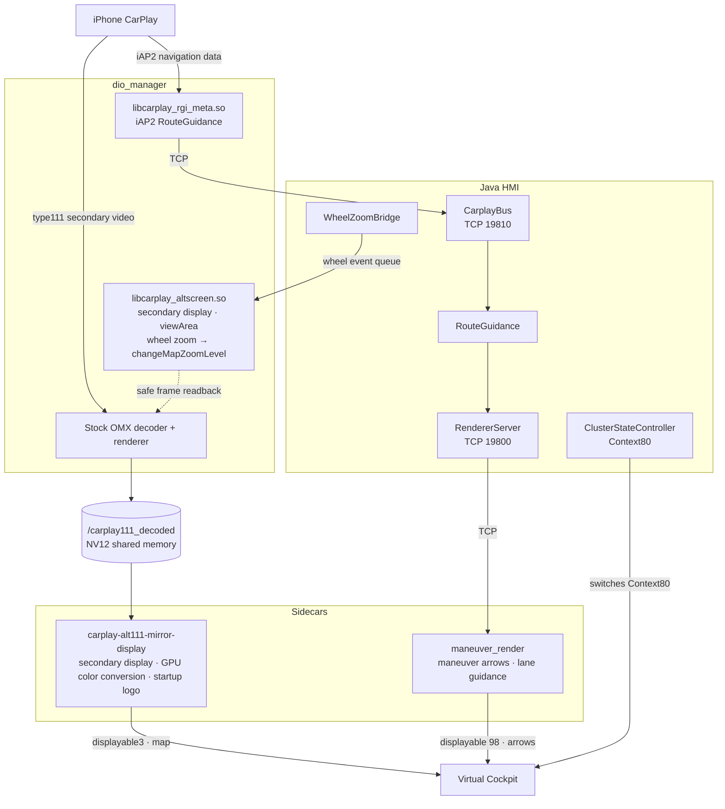

# MIB2 Toolbox — CarPlay AltScreen V3.8 Fix1

**English** | [简体中文](README.md)

This project is designed for the Audi **MHI2Q** platform and displays the **native CarPlay AltScreen / secondary navigation view** directly on the vehicle's **Virtual Cockpit**. The core display path has been verified in a vehicle. Read this document in full before making changes to the head unit.

**V3.8 Fix1 update (plain-language: the things that were fixed):**
- **Answering a CarPlay call from the cluster or the steering wheel connected it, then hung it up a second or two later** — the call now stays connected until you hang up. (Validated in a vehicle.)
- **Times in the cluster telephone tab's recents were 8 hours behind the phone** — they now show the head unit's local time, matching the phone.
- **Switching between the big map and the small map left half a frame showing on the cluster** — it now goes black briefly and fades in the new view once it's ready, so you no longer see a half-drawn screen.
- **The turn arrow jumped abruptly when it appeared or disappeared** — it now fades in and out.
- **On the Audi Q7, the turn arrow didn't show when navigating with CarPlay only** — the arrow now appears.
- **A stray grey box / backing plate showed on the cluster during navigation** — it's gone now, only the turn arrow remains.
- **Installing or restoring failed after SD-card folders had been copied by a computer (especially a Mac)** — this is now tolerated and no longer aborts.
- The green-menu header now reads "V3.8 Fix1".

> [!TIP]
> If the head unit boots with this project's SD card inserted, it restores that card as its "media" audio source, but the card holds no playable music. So right after CarPlay connects, while the phone is not playing anything yet, turning the volume reports it as unavailable; it works again as soon as the phone plays audio. This is the stock source logic, not a fault. After installing you can leave the card out for everyday driving and insert it only to collect logs.

**V3.8 update: CarPlay calls on the cluster telephone tab (ported from [Luka's mib2q-carplay-rgi](https://github.com/luka-dev/mib2q-carplay-rgi) CarPlay Telephony); the cluster's lower info bar shows the estimated arrival time after the road name; new install modes with the iPhone's maneuver card; fixed the cluster display staying blank on the first connection; the project's original parts are now under a noncommercial license that forbids selling.**

**V3.7 update: full RGI navigation-data integration is now available (built on [Luka's mib2q-carplay-rgi](https://github.com/luka-dev/mib2q-carplay-rgi)), color conversion for the secondary display now runs on the GPU, cutting whole-system CPU usage from about 80% to about 20%, the runtime watermark has been removed, and starting with V3.7 the whole project is open source under GPL-3.0.**

**Wireless CarPlay: tested with the 君用 (Junyong) M2Pro wireless adapter on its latest beta firmware, which fully supports the cluster display, RGI, steering-wheel zoom and CarPlay projection.**

**V3.7Fix6 update: fixes the missing secondary display on the cluster once the LTE data link is up. The head unit then switches to per-uplink firewall configurations such as `pf.ecm0.conf`, and the installer now writes the 6031 pass rule into those as well.**

**V3.7Fix5 update: the secondary-display data port is fixed at 6031 and written into the head unit's firewall configuration, fixing the black cluster at cold start and cluster dropouts when LTE changes IP; at cold start the secondary display waits until the stock cluster map has loaded; fixes RGI lane guidance disappearing mid-route; the startup video now fills the cluster 1:1; the green menu is trimmed to three entries, and boot logs are saved to the SD card automatically.**

> [!CAUTION]
> **Disclaimer**
>
> - Every change this project makes is written to, and affects, the head unit's system files. Installing, updating, starting and restoring all modify stock programs, configuration and firewall rules, and can affect how the head unit works.
> - This project is provided free of charge and "as is", without warranty of any kind (see the No Liability section of the PolyForm Noncommercial 1.0.0 and sections 15 and 16 of the GPL-3.0).
> - **By using this project you accept these risks and take full responsibility for the consequences. The authors and contributors accept no liability for any problem arising from using, installing, restoring or modifying this project, including but not limited to head-unit faults, malfunctions, failure to boot, data loss, voided warranty, or any other direct or indirect damage.**
> - If you do not agree to these terms, do not install or use this project.

> [!CAUTION]
> **Public statement: we strongly condemn VWODIS (一车网) for stripping the authors' names and license from this project and reposting it to draw traffic**
>
> On October 13, VWODIS (一车网, QQ: **296520384**) published this project on its website as "【Software】Audi MHI2Q-CARPLAY-Altscreen Native Second-Screen Navigation Activation Software V3.7" ([en.vwodis.com/20912.html](https://en.vwodis.com/20912.html)), priced at **$200** for the general user group or 2,000 points at the "Sergeant" (中士) level, with login required to download. The listing:
>
> - does not name the original authors or link to this GitHub repository;
> - does not include the GPL-3.0 license or any way to obtain the source code;
> - takes its description from this project's README.
>
> GPL-3.0 allows charging for copies, but anyone who redistributes this project must keep the authors' copyright and license notices and provide the complete source code (sections 4 and 6). Redistributing in violation of the license automatically terminates all rights granted under it (section 8). When the author contacted them, they admitted posting it, then replied: "We haven't kept the source closed, and it isn't encrypted", "It's just to attract traffic", "What does it have to do with you?" and "Then just don't publish it."
>
> **We strongly condemn taking open-source authors' work to draw traffic for themselves while erasing the authors' names and license, and we demand that they correct the listing or take it down immediately.**
>
> **This project is published free of charge only on GitHub ([yuedizhibo/MHI2Q-CarPlay-AltScreen](https://github.com/yuedizhibo/MHI2Q-CarPlay-AltScreen)). Any paid, points-based or membership download channel has nothing to do with the authors.** Files from third-party channels may be modified or mixed with old versions; download only from this repository's Releases.

<details>
<summary>Evidence: the listing, its price and the chat with the site operator (in Chinese, click to expand)</summary>


</details>

> [!NOTE]
> **Sister project: MMI Mirror**  
> If you want to mirror the **entire MMI center display** instead of using the native CarPlay secondary display, see:  
> **[MHI2Q-CarPlay-MMI-Mirror](https://github.com/Lanye-z/MHI2Q-CarPlay-MMI-Mirror)**

> [!TIP]
> **Community**  
> Join the community to discuss installation and use, report problems, and share vehicle test results:  
> - Telegram: [https://t.me/+xZ2pabi2nmk1MDI9](https://t.me/+xZ2pabi2nmk1MDI9)  
> - QQ group: **823297190**

> [!WARNING]
> **⚠️ A note before you start**
>
> Because freely shared test builds were previously repackaged and resold without permission, earlier versions of this project published only the runtime package and released features in stages. **Starting with V3.7, the project is fully open source**: every feature and all source code are published in this repository.
>
> **Starting with V3.8, this project's original parts may not be sold.** The second-screen hook, the display process, the install scripts, the green menu and the documentation are now licensed under **PolyForm Noncommercial 1.0.0 + [Additional Terms](Toolbox/carplay_alt_screen/LICENSE.ADDITIONAL-TERMS.md)**: individuals may use, study and modify them and share them free of charge; selling them or distributing them for a fee is prohibited; anyone who installs them for others for a fee may charge at most CNY 100 in total per vehicle per installation. The Java HMI and RGI parts based on Luka's and Allemon's work remain under GPL-3.0. See "Licensing, authors, and third-party files" below.
>
> This is not a demonstration build. The current CarPlay AltScreen functionality is already usable in a real vehicle.
>
> This project was originally developed around our own vehicles and day-to-day use cases. **China-region (CN) AUG22 firmware has been tested in a vehicle and works normally.** Some European-region (ER) AUG22 firmware has been reported working in vehicles by users (for example `MHI2Q_ER_AUG22_P5092` / `P5152`, MU 1329). **US-region (US) AUG22 firmware `MHI2Q_US_AUG22_P4246`, MU 1320 has been vehicle-tested (2018 Audi Q5, North America, V3.8) — see [docs/vehicle-tests](docs/vehicle-tests/2018-audi-q5-us-aug22-p4246.md).** Other ER / US versions and firmware for other regions may have unknown bugs and are **not guaranteed to work 100%**; assess the risk yourself and keep your stock backup. The MHI2 platform is not supported. Do not bypass the installer's firmware checks to force installation.
>
> **Shared free of charge.** The source and installation packages are available for free on GitHub; do not pay for them.
>
> You are welcome to learn from, study, and discuss the project. If someone sells you this project, or charges you more than CNY 100 to install it, please report it through Issues.

> [!IMPORTANT]
> This project modifies system files on the head unit. Keep the SD card inserted and maintain stable power during installation, start, or recovery operations.  
> **After installation or recovery, fully reboot the head unit / HMI as instructed before judging the result.**
>
> Do not perform installation, update, recovery, or troubleshooting while driving.

---

## Vehicle demonstration


---

## Currently included in the public release

- Native CarPlay AltScreen
- The main CarPlay display remains available and unaffected
- Wireless CarPlay: the 君用 (Junyong) M2Pro wireless adapter on its latest beta firmware has been tested to support the cluster display, RGI, wheel zoom and CarPlay projection
- Full RGI navigation-data integration (built on [Luka's mib2q-carplay-rgi](https://github.com/luka-dev/mib2q-carplay-rgi))
  - Maneuver arrows and lane guidance on the cluster
  - Can be enabled or left out at install time (enabled by `INSTALL WITH RGI` / `INSTALL WITH RGI CARD`; `INSTALL WITH NOTHING` / `INSTALL WITH CARD` show no maneuver arrows)
- CarPlay calls on the cluster telephone tab (**ported from [Luka's mib2q-carplay-rgi](https://github.com/luka-dev/mib2q-carplay-rgi) CarPlay Telephony**)
  - Stock shows only "Your iPhone is in Apple CarPlay mode" on the tab; now it shows ringing, dialing, active and held calls with the caller's name, number and the call timer, like a Bluetooth phone
  - Accept, hang up, hold / resume, swap between two calls and mute the microphone from the cluster and the steering wheel
  - Recents (iPhone sends at most 12) and favorites, dialable from the list; missed-call indication, signal bars and carrier
  - The TEL key on the head unit goes straight to the CarPlay phone instead of the "Apple CarPlay mode" popup
  - CarPlay gives the car no phonebook and no caller picture: the cluster Directory shows "no phonebook"
  - Active in every install mode; with a Bluetooth phone everything stays stock
- The cluster's lower info bar shows the estimated arrival time after the road name, for example "Main St | 14:35"; available in every install mode, and not shown twice when the navigation app already includes it
- iPhone maneuver card (`INSTALL WITH CARD` / `INSTALL WITH RGI CARD`): the iPhone draws its maneuver card next to the cluster map; choose its position with `CARD LEFT` / `CARD TOP` / `CARD RIGHT` in the green menu. For now the card appears only in the full-map view of the B9 (A4/A5 and similar) and Q7 layouts
- Classic / Sport dynamic layout adaptation
- Global centering
- Left steering-wheel scroll-wheel zoom
- Cluster map shows the speed-limit sign and compass, without an ETA overlay on the map (the arrival time is in the lower info bar)
- GPU color conversion: whole-system CPU usage cut from about 80% to about 20%
- At cold start, the secondary display waits for the stock cluster map to be ready
- Fixed-port firewall rule for the secondary display; no dropouts when LTE changes IP
- Safe installation and recovery
- Protection against interrupted installation / recovery
- Restoration of stock configuration
- Boot logs saved to the SD card automatically; stock backups kept on the SD card

## Compatibility

| Item | Status |
|---|---|
| Platform | **MHI2Q** only; MHI2 is not supported |
| Firmware version | **AUG22**; the installer checks the head unit's firmware version and refuses anything other than AUG22 |
| China-region (CN) firmware | ✅ Vehicle-tested and works normally |
| Some European-region (ER) firmware | ✅ Reported working in vehicles by users (for example `MHI2Q_ER_AUG22_P5092` / `P5152`, MU 1329) |
| US-region (US) firmware | ✅ Vehicle-tested: `MHI2Q_US_AUG22_P4246`, MU 1320 (2018 Audi Q5, North America, V3.8) — see [docs/vehicle-tests](docs/vehicle-tests/2018-audi-q5-us-aug22-p4246.md) |
| Other ER / US versions and other regional firmware | ⚠️ May have unknown bugs; not guaranteed to work 100% |
| Wireless CarPlay adapter | ✅ 君用 (Junyong) **M2Pro** on its latest beta firmware: tested with full support for the cluster display, RGI, wheel zoom and CarPlay projection |
| iPhone iOS version | ✅ **iOS 26** recommended; ⚠️ below iOS 18, Baidu Maps may not support the cluster display and Amap (Gaode) may show the map with the wrong aspect ratio |

> [!TIP]
> This project was adapted and tested mainly on **iOS 26**. If Baidu Maps does not appear on the cluster, or Amap (Gaode) looks stretched or squashed, update the iPhone to iOS 18 or later (iOS 26 recommended) before troubleshooting further.

---

## How it works and architecture

This project no longer relies on the early Window58 readback route. It connects directly to CarPlay's **private type111** secondary-display video stream: the stock AirPlay / OMX decoding path is kept, frames are safely read from the stock renderer and linearized into standard NV12, handed to a separate display process, and finally shown on the cluster through GLES / displayable3 / Java Context80. Full RGI receives navigation data through iAP2 RouteGuidance, and the Java HMI forwards it to a separate maneuver renderer.

### Architecture diagram



### Secondary-display path

```text
iPhone CarPlay
  ↓
private type111 secondary-display video stream
  ↓
Stock AirPlay / OMX decoding
  ↓
QNX Screen readback + linearization → standard NV12 (/carplay111_decoded)
  ↓
Separate display process (carplay-alt111-mirror-display)
  ↓
GPU shader converts NV12 → RGBA
  ↓
GLES / displayable3 (1440×542 source shown 1:1 on the 1440×455 cluster plane)
  ↓
Java/HMI Context80
  ↓
Virtual Cockpit
```

- The main CarPlay display (Main110) stays on the stock path and is not part of this display path.
- No extra decoder is introduced; the stock decoding path that already works on MHI2Q is reused to keep new variables to a minimum.
- The FULL / SMALL view areas switch dynamically within the same CarPlay session through the standard `updateViewArea`; the Classic / Sport layout follows the head unit's HMI state.
- Java/HMI is the only owner of Context80; the display process does not change the cluster Context directly.
- Secondary-display data uses fixed TCP port 6031: the installer writes a pass rule, ahead of the carplay0 block rule, into the head unit's `pf.conf` and into the per-uplink `pf.ecm0.conf`, `pf.ppp0.conf`, and `pf.mlan0.conf`, so it loads at boot with the stock firewall configuration and no `pfctl` runs while the secondary display is being set up. When the head unit reloads the firewall configuration because LTE changed IP, or switches to `pf.ecm0.conf` and the like once the LTE data link is up, the rule is loaded again with it. The rule goes into all of these files or into none; if it is not written or the port is taken, the hook falls back to a random port plus a runtime pass rule.

### Cold start: waiting for the stock cluster map

At cold start, the Java HMI checks every 500 ms, on the stock navigation thread, whether the cluster map (MapKombi) has been initialized. Once it has, it notifies `libcarplay_rgi_meta.so` over the local bus (TCP 19810, command `0x0119`), which hands the notice to `libcarplay_altscreen.so`. Until then the hook does not ask the iPhone for the secondary-display picture (`showUI` / `forceKeyFrame`), does not switch view areas, and the display process does not start, so both the startup video and the secondary display appear only after the stock map is ready. The main CarPlay display, the secondary-display capability exchange, and the iPhone setting up the secondary video stream are not delayed.

This waits for the stock cluster map object to finish initializing, not for a GPS fix or an active route. Readiness is kept in memory only; hiding the stock map later does not close the gate again. There is no timeout: if the stock cluster map never comes up, the secondary display keeps waiting.

### Performance: GPU color conversion

In earlier versions, the display process converted each decoded NV12 frame to RGBA on the CPU before uploading it to the GPU, which put a heavy load on the head unit. V3.7 moves the NV12 → RGBA color conversion to the GPU: the display process uploads the Y and UV planes as separate textures and a GLES fragment shader does the conversion, so the CPU no longer touches every pixel and no intermediate RGBA buffer is allocated.

In vehicle testing, **whole-system CPU usage dropped from about 80% to about 20%**.

### RGI navigation-data path

- `libcarplay_rgi_meta.so` receives iAP2 RouteGuidance data inside the stock CarPlay process and passes it to the Java HMI over local TCP port 19810. Every install mode loads it and starts this local bus, which also carries the stock-map readiness notice. The modes without RGI, `INSTALL WITH NOTHING` / `INSTALL WITH CARD`, still receive navigation data, but use it only for the road name and arrival time in the lower info bar and do not start the maneuver renderer.
- Maneuver arrows and lane guidance are sent over local TCP port 19800 to the separate `maneuver_render` process, which draws them on displayable 98. The process is supervised by `rgi_supervisor.sh` and restarted a limited number of times if it exits unexpectedly.

### Lower info bar: road name and arrival time

During navigation the Java HMI writes the road name and the estimated arrival time into the cluster's lower info bar (BAP FctID 19) as "road | arrival time". If the text from the navigation app already contains an arrival time, only one is kept. `INSTALL WITH RGI` / `WITH RGI CARD` also take over the maneuver arrow, distances and remaining time; `INSTALL WITH NOTHING` / `WITH CARD` write only this one line and leave everything else to the stock behavior.

### iPhone maneuver card

With `INSTALL WITH CARD` / `WITH RGI CARD`, the hook declares a cluster layout with a maneuver card to the iPhone and widens the full-map area, and the iPhone draws the card directly in the secondary-display video. `CARD LEFT` / `CARD TOP` / `CARD RIGHT` store the position on the head unit; the hook reads it every 100 ms, so with CarPlay connected it applies right away in the full-map view without reconnecting. A new INSTALL resets it to the default, TOP. The small-map view and layouts other than B9 and Q7 have no room for the card and show only the map.

### Cluster telephone tab

This feature is ported from [Luka's mib2q-carplay-rgi](https://github.com/luka-dev/mib2q-carplay-rgi) CarPlay Telephony (see its `docs/cluster-and-rgi/CARPLAY_TELEPHONY.md`) and adapted to this project's single HMI JAR.

- While CarPlay is connected, stock tells the cluster over BAP that the phone is in Apple CarPlay mode, so the telephone tab shows only a note. The Java HMI wraps the stock cluster phone service: only while stock itself reports CarPlay, it presents a hands-free phone to the cluster and fills in CarPlay's calls, lists and signal; when CarPlay goes away it replays stock's values. With a Bluetooth phone everything passes to stock unchanged.
- Call state comes from the stock terminal-mode event bus (stock already forwards the DSICarplay call state there), and dialing uses stock CarPlay's `tel:` dial. Unlike Luka's version, this project does not replace `CarplayDSILifecycleController` (Luka keeps a separate patch of that class for the CN firmware); it uses only public interfaces and runtime wrapping, so one HMI JAR serves US (MU1316), EU (MU1329) and CN (MU1003).
- One press of the steering-wheel phone key reaches CarPlay twice: the cluster's BAP accept / hang-up (turned into iAP2 by this project) and the stock MFL phone key sent to the iPhone as a HID key. On a car where the HID key works, the second copy hangs up the call that was just answered. The Java HMI wraps the phone controller of the stock `DSISmartphoneManagerProxy` at runtime and drops the stock copy (hook / hangup / flash) only while the cluster telephone tab shows a CarPlay call and a call exists; other keys and the stock's other hang-up paths are untouched. This is equivalent to Luka's change in `postDSICarplayButtonEvent` without replacing any stock class. Stock rewrites that controller on every device switch, so the wrapper is re-armed on CarPlay activation and on every call-state update; if it cannot be installed it does nothing and stock behavior is unchanged.
- Recent-call times arrive from the iPhone as UTC timestamps and are shown in the head unit's own time zone and DST, matching the head-unit clock and the arrival time in the lower bar.
- The telephony module in `libcarplay_rgi_meta.so` subscribes to recents and favorites over iAP2, reads the signal, carrier and battery data stock already subscribes to, and sends accept, end, swap, hold and mute to the iPhone; it talks to Java over the same local TCP port 19810. INSTALL registers the 7 iAP2 message IDs (`0x415B`–`0x415D`, `0x415F`, `0x4160`, `0x4170`, `0x4171`) in `dio_manager.json`; RESTORE puts the original file back.
- Three stock classes are replaced: `ServiceManagerPhone` and the phone and system state-machine `Activator`s. They are byte-identical on all three firmware trains; if this project's telephony classes cannot load, the stock objects are used, so the stock phone and the HMI start as before.

### Steering-wheel zoom

The Java HMI captures the left steering-wheel scroll events and writes them to an event queue. `libcarplay_altscreen.so` steps toward the target zoom level by sending standard `changeMapZoomLevel` requests to the iPhone, pacing them by fresh secondary-display frames.

---

## Source layout and building

Starting with V3.7, all source code is in this repository:

| Path | Contents | Output |
|---|---|---|
| `Toolbox/carplay_alt_screen/src/` | Preload hook for the stock CarPlay process: private111 secondary display, frame readback, viewArea, wheel zoom | `universal/libcarplay_altscreen.so` |
| `Toolbox/carplay_alt_screen/mirror_display/` | Secondary-display process (C++ / GLES / displayable3) with GPU color conversion and the embedded startup logo | `mirror_display/release/carplay-alt111-mirror-display` |
| `Toolbox/carplay_alt_screen/rgi_native/` | RGI preload hook: iAP2 RouteGuidance parsing and forwarding, stock-map readiness forwarding; `telephony/` is the iAP2 module of the cluster telephone tab (ported from Luka's mib2q-carplay-rgi) | `rgi_meta/libcarplay_rgi_meta.so` |
| `Toolbox/carplay_alt_screen/rgi_renderer/` | Maneuver-arrow / lane-guidance renderer | `rgi_renderer/release/maneuver_render` |
| `Toolbox/carplay_alt_screen/hmi/` | Java HMI hook: Context80, cluster layers, RGI distribution, wheel events, stock-map startup wait; `src/com/luka/carplay/telephony/` and the replaced stock classes under `src/de/audi/` are the cluster telephone tab (ported from Luka's mib2q-carplay-rgi); `stubs/` holds compile-only stock API stubs and `vendor/` the baseline JAR; source for its classes that are not compiled from `src/` is in `vendor/src/`, with per-class notes in `vendor/SOURCES.md` | `hmi/carplay_hook-basevideo3.jar` |
| `Toolbox/scripts/`, `Toolbox/GEM/` | Install / start / status / restore / diagnostic scripts and the green menu | Used from the SD card |
| `Tools/`, `BUILD-*.sh` | Build and verification tools | — |

Building requires the QNX 6.5.0 SDP ARM cross toolchain (`arm-unknown-nto-qnx6.5.0eabi-gcc`):

```sh
sh BUILD-UNIVERSAL-QNX.sh      # secondary-display hook → libcarplay_altscreen.so
sh BUILD-MIRROR-QNX.sh         # secondary-display process → carplay-alt111-mirror-display
bash Tools/build_rgi_qnx.sh    # RGI hook + renderer → libcarplay_rgi_meta.so, maneuver_render
```

Build output goes to `dev-build/` or `mirror_display/build/` (not tracked in git) and does not overwrite the vehicle files in `release/`. When you replace vehicle files, also update the matching `BUILD_INFO.txt`, `SHA256SUMS`, and the root `SHA256SUMS-SD.txt`.

---

## Installation and testing

> [!IMPORTANT]
> **This repository is now an AltScreen overlay only. It no longer contains the complete MIB2 Toolbox installer.**
>
> - The **red software-update menu** is only for installing or repairing the upstream [jilleb/mib2-toolbox](https://github.com/jilleb/mib2-toolbox).
> - **This project itself cannot be installed directly through the red software-update menu.**
> - After the upstream Toolbox is working, load this project through **`MQBCoding → Update Toolbox`** in the green menu.
> - If `Update Toolbox` reports `Script not found` or `/eso/hmi/engdefs/scripts/mqb/update_toolbox.sh` is missing, repair/reinstall the upstream Toolbox first.
> - **Upgrading from an older version no longer needs a manual restore**: the installer removes the old version automatically before installing. See section 8.

### 1. Confirm that the upstream MIB2 Toolbox works

1. Check that the head unit's firmware version is **AUG22**. The installer verifies the firmware version and refuses non-AUG22 firmware. Stop if the version differs or cannot be confirmed; do not bypass the checks. For firmware outside the China region, read "Compatibility" above first.
2. Park the vehicle and maintain stable power. Back up the current SD card and stock files, then prepare a writable **FAT32** SD card. If the old card contains `MMI-Cockpit-Carplay`, preserve that entire directory when changing cards because it contains stock backups needed for restoration.
3. If `Green Developer Menu → MQBCoding` already works and **`Update Toolbox` runs normally without a Script not found error**, skip directly to section 2.
4. If the upstream Toolbox is not installed, or the green menu exists but `Update Toolbox` is broken / missing its script, download and extract the latest complete **[jilleb/mib2-toolbox](https://github.com/jilleb/mib2-toolbox)** package. Copy the **contents** of that upstream package to the SD-card root without an extra ZIP-name folder.
5. Insert only that SD card in the head unit. Enter the red menu and select `Software updates/versions → Update → SD card → MQB Coding MIB2 Toolbox`. Wait for the update and all automatic reboots to finish; do not remove the card or cut power early.
6. After reboot, open `Green Developer Menu → MQBCoding` and confirm that **`Update Toolbox` runs normally**. If the upstream package is not recognized, check FAT32 format, root layout, and the upstream instructions. Stop if it is still rejected; do not force-flash it.

### 2. Merge this project overlay into the upstream Toolbox SD card

1. Keep the **complete upstream MIB2 Toolbox SD-card contents**. Do not delete its `metainfo2.txt`, `Toolbox/final/`, `Toolbox/GEM/mqb-main.esd`, `Toolbox/scripts/update_toolbox.sh`, or other upstream files.
2. Download the package from this repository's [Releases](https://github.com/yuedizhibo/MHI2Q-CarPlay-AltScreen/releases) page and extract it. These are compiled vehicle overlay files; **you do not need to copy source code or build directories**. Merge the package's **`Toolbox/` directory into the existing `Toolbox/` directory on the SD card**:
   - Replace same-name files with this project's versions.
   - Keep all upstream-only files.
   - When upgrading from an older project build (after completing the restore in section 8), delete the old `logo.rgba` and `watermark.rgba` from `Toolbox/carplay_alt_screen/mirror_display/release/` on the card; the new binary does not use them.
   - **Do not wipe the upstream Toolbox first, and do not treat this repository as a standalone red-menu update package.**
3. Also copy `SHA256SUMS-SD.txt` from the package root to the SD-card root for the check in the next step. If changing cards, also preserve the complete `MMI-Cockpit-Carplay` stock-backup directory.
4. The resulting layout should look like:

```text
SD card root/
├─ metainfo2.txt                  ← keep from upstream Toolbox
├─ Toolbox/
│  ├─ final/                      ← keep from upstream Toolbox
│  ├─ GEM/
│  │  ├─ mqb-main.esd             ← keep from upstream Toolbox
│  │  └─ mqb-carplayAltScreen.esd ← this project
│  ├─ scripts/
│  │  ├─ update_toolbox.sh        ← keep from upstream Toolbox
│  │  └─ ...AltScreen scripts...  ← this project
│  └─ carplay_alt_screen/         ← this project payload
└─ SHA256SUMS-SD.txt
```

5. Do not add an extra `SD card/Toolbox/` or `MHI2Q-CarPlay-AltScreen/Toolbox/` directory level.
6. From the SD-card root, run:

```sh
sha256sum -c SHA256SUMS-SD.txt
```

with Git Bash, Linux, or another environment that provides `sha256sum`. Confirm that every project file reports `OK`. This manifest validates this project's overlay files, not the complete upstream Toolbox.

### 3. Load this project's menu and scripts through the green menu

1. Reinsert the merged SD card.
2. Open `TESTMODE → Green Developer Menu → MQBCoding`.
3. Run **`Update Toolbox`**. The upstream Toolbox update script copies the SD card's `Toolbox/scripts/` and `Toolbox/GEM/` contents into the head unit.
4. Exit and reopen the green menu, then open:

```text
Customization
└─ MMI-Cockpit-Carplay
```

   Check that the version in the menu header matches the package you downloaded (currently **`Version: V3.8 Fix1`**) and that the menu has four install entries (`INSTALL WITH NOTHING`, `INSTALL WITH RGI`, `INSTALL WITH CARD`, `INSTALL WITH RGI CARD`), three card-position entries (`CARD LEFT`, `CARD TOP`, `CARD RIGHT`), and `RESTORE ORIGINAL`. If it still shows an older version, the menu and scripts on the head unit are still the old ones, and `INSTALL` would run the old installer; run `Update Toolbox` again and continue only once the version is correct.

5. If you still see:

```text
Script not found:
/eso/hmi/engdefs/scripts/mqb/update_toolbox.sh
```

the **upstream Toolbox base installation is still broken**. Do not continue with this project's `INSTALL`; return to section 1 and repair the upstream Toolbox first.

### 4. Install the secondary display

Installing and enabling are now one step, so **only one reboot is needed**:

1. **Disconnect the iPhone / CarPlay** so navigation video is not playing during installation.
2. In the `MMI-Cockpit-Carplay` menu, select one install mode:
   - `INSTALL WITH RGI` (recommended): secondary-display map + full RGI (maneuver arrows, lane guidance) + road name and arrival time in the lower info bar.
   - `INSTALL WITH RGI CARD`: everything in `INSTALL WITH RGI`, plus the iPhone's maneuver card.
   - `INSTALL WITH CARD`: secondary-display map + the iPhone's maneuver card + road name and arrival time in the lower info bar, without maneuver arrows.
   - `INSTALL WITH NOTHING`: secondary-display map + road name and arrival time in the lower info bar, without maneuver arrows or the card; useful if you only want the map or are troubleshooting RGI.

   For now the maneuver card appears only in the full-map view of the B9 (A4/A5 and similar) and Q7 layouts. Choose its position with `CARD LEFT` / `CARD TOP` / `CARD RIGHT`; the default is TOP, a change applies right away while CarPlay is connected, and a new INSTALL resets it to TOP.
3. Wait for the final `RESULT:` line. Do not remove the card, cut power, or reboot before it appears. The installer runs five steps and shows each one live:

   ```text
   [1/5] Checking package and firmware...
   [2/5] Checking for a previous installation...   (removes an old version automatically)
   [3/5] Installing AltScreen + RGI...            (rolls back on any error)
   [4/5] Enabling autostart...
   [5/5] Verifying installation...
   ```

4. After `RESULT: SUCCESS`, **fully reboot the head unit once**, then connect the iPhone, enter CarPlay, start navigation, and check that the Virtual Cockpit shows the secondary display and updates with navigation. At cold start the secondary display appears only after the stock cluster map has loaded; this is expected.
5. If it shows `RESULT: FAILED`, the lines below it say which step failed, what state the head unit is in now (unchanged / rolled back / restored to stock), and what to do next. The full run is in the SD-card log shown after `Log:`.

The install mode is recorded as `INSTALL_RGI_MODE=WITH / NO` and `INSTALL_CARD_MODE=WITH / NO` in the install log on the SD card (`MMI-Cockpit-Carplay/logs/operations/install_*.log`). To switch modes, simply run INSTALL again with the other mode; the installer removes the current version first.

The cluster telephone tab and the arrival time in the lower info bar are enabled in every install mode. After upgrading from an older version, run INSTALL once more and fully reboot so the iAP2 message IDs they need are registered.

> [!NOTE]
> When the secondary display starts, it first plays a startup video of about 5 seconds (filling the cluster) and then switches to the CarPlay picture. This is expected. It is not the vehicle boot logo.

### 5. Troubleshooting

- Judge success by the **image actually shown on the Virtual Cockpit**.
- If the `MMI-Cockpit-Carplay` menu is missing, first confirm that the upstream green menu works, the SD-card directory layout is correct, and `MQBCoding → Update Toolbox` completed successfully.
- If `Update Toolbox` itself reports `Script not found`, that is an upstream Toolbox base-installation problem rather than an AltScreen installer problem. Repair the upstream Toolbox through the red software-update menu first.
- If the cluster never shows the secondary display after a cold start, first check that the stock navigation map shows normally on the cluster. This project waits for the stock cluster map to initialize before asking for the secondary display, so if the stock map does not come up, the secondary display will not appear either. In the boot log `hook_tmp.log`, `PHASE=OEM_MAP_READY` means the wait is over; only `PHASE=ALT111_REQUEST_DEFERRED ... reason=oem_map_not_initialized` means it is still waiting for the stock map.
- If Baidu Maps does not appear on the cluster or Amap (Gaode) shows the wrong aspect ratio, first make sure the iPhone runs iOS 18 or later (iOS 26 recommended).
- If the SD card is not detected, check FAT32, root layout, and read/write status. If the secondary display shows no picture, confirm that CarPlay is connected and navigation is producing video, then save the logs and report it; do not reinstall repeatedly.

### 6. Logs

- After installation, each boot's runtime logs are saved automatically to `MMI-Cockpit-Carplay/logs/boots/boot_*/` on the SD card (the card must be inserted at boot). They cover private111 connect / teardown, H.264, Screen readback, decoded SHM, display frame rate, displayable3, Context80, view-area and layout state, firewall rules and network state, and the stock system log.
- Logs from install, restore, and other operations are saved to `MMI-Cockpit-Carplay/logs/operations/` on the SD card.
- Live logs on the head unit are under `/tmp/`, for example `/tmp/altscreen_hook.log` and the RGI renderer's `/tmp/maneuver_render.log`.
- Cluster telephone tab logs: the Java side writes to `carplay_hook.log` (`TELEPHONY_BRIDGE`, `TELEPHONY_GATE`, `TELEPHONY_LISTS`, `TELEPHONY_ACTION`, `TELEPHONY_POPUP_SKIP`, plus `TELEPHONY_STOCK_HID_FILTER installed / re-armed / not installed` and `TELEPHONY_STOCK_HID_DROPPED` for the steering-wheel phone-key filter), the iAP2 side to `carplay_rgi_native.log` (`TELEPHONY_READY`, `TELEPHONY_LISTS_REQUESTED`, `TELEPHONY_CMD`). Both are saved with the boot logs under `streams/` on the SD card.
- When something goes wrong, save the complete logs before changing any configuration or code. When reporting an issue, attach the whole `MMI-Cockpit-Carplay/logs/` directory from the SD card and include the firmware version and region, the Classic / Sport and FULL / SMALL layout, and how the phone was connected (phone plugged in before the head unit started / after it fully started / quick reconnect).

### 7. Restore the stock configuration

1. Insert the SD card that retains the `MMI-Cockpit-Carplay` stock-backup directory and select `RESTORE ORIGINAL`. Logs from earlier boots are already on the SD card, so there is no need to export them before restoring.
2. Wait for the final `RESULT:` line. `RESULT: SUCCESS` means the stock configuration is back; then fully reboot the head unit. Restore stops the display process, releases the Context80 display demand, removes the startup entries, removes this project's HMI JAR, and restores the HMI files and preload configuration saved before installation.
3. If it shows `RESULT: FAILED`, follow the lines below it; if they say the rollback was incomplete, **do not reboot** and run `RESTORE ORIGINAL` again. A head unit that is already stock shows `RESULT: NOTHING TO RESTORE`.

### 7.1 Rescue restore with a backup from the same model and firmware

Normal `RESTORE ORIGINAL` and the automatic uninstall in INSTALL step 2 check the live files against the stock backup. Differences beyond this project's expected edits are refused. A VIN mismatch now produces a warning that a backup from another vehicle is being used; it does not bypass the normal file checks.

If damaged files prevent normal restore, you can enable rescue mode manually. **Use a complete, clean stock backup from the same head-unit model and the exact same firmware train.** Different regions or trains are not interchangeable, and matching MU numbers alone are insufficient. The script enforces the recorded train; confirm the matching head-unit model before borrowing a backup.

1. Save the current SD card, your own stock backup, and the logs to a separate directory on your computer first. Preserve those original copies.
2. Use the current Toolbox package. Place the **complete matching backup directory** under `MMI-Cockpit-Carplay/backup/` on the SD card, including `original`, `firewall-original`, `universal-hook-original`, other original subdirectories, and checksum files. Do not copy only selected libraries or JSON files.
3. Create an empty **file** named **`MMI-Cockpit-Carplay/RESCUE_RESTORE`** on the SD card. It is not a directory and has no `.txt` extension. Enable file-extension visibility in Windows and verify that it is not `RESCUE_RESTORE.txt`.
4. Insert the SD card, keep power stable, disconnect the phone, and select **`RESTORE ORIGINAL`** in the green menu. The screen shows `RESCUE MODE`. A firmware mismatch, unreadable train, incomplete backup, or checksum failure is refused. **Legacy backups without a recorded firmware train cannot be used for rescue; there is no second override marker.**
5. Rescue permits overwriting differing system binaries and configurations: `dio_manager`, `libairplay.so`, `libNmeBaseClasses.so`, the two CarPlay JSON configurations, `pf.conf`, and per-uplink firewall configurations such as `pf.ecm0.conf`. A separate transaction snapshot captures this head unit's current state before writes so a failed restore can roll back. That snapshot is not a new clean stock backup and does not replace either original backup. Earlier interrupted transactions are retained under `install-transaction/rescue-preserved.*` or `restore-transaction/rescue-preserved.*`; they are not used as rescue payloads.
6. Wait for **`RESULT: RESCUE SUCCESS`**, save the logs, delete **`MMI-Cockpit-Carplay/RESCUE_RESTORE`**, and fully reboot the head unit. On failure, follow the result instructions; the marker's presence does not mean rescue succeeded.

The marker applies to the manual `RESTORE ORIGINAL` only. While the marker is present, every later manual restore runs in rescue mode, so always delete it once the rescue is done. **INSTALL's automatic uninstall always retains normal strict checks, even with this marker present.** Rescue restores only files covered by this project's backup; it does not replace a full firmware reflash or guarantee repair of other damaged system files.

### 8. Upgrade from an older version

Upgrading **no longer needs a manual restore**:

1. Disconnect the iPhone / CarPlay and insert the SD card that retains the `MMI-Cockpit-Carplay` stock-backup directory (the card used for the original install).
2. Merge the new overlay into that SD card as described in section 2, and delete the leftover `logo.rgba` and `watermark.rgba` from the old version. Keep the `MMI-Cockpit-Carplay` directory on the card intact.
3. Run `Update Toolbox` as described in section 3, then choose an install mode and run INSTALL as described in section 4. When the installer finds an old version, it first runs a full, verified restore, then installs the new version.
4. After `RESULT: SUCCESS`, fully reboot the head unit once.

If the card holds no stock backup (for example, after switching SD cards), the installer stops at step 2 with a message and does not change the head unit.

Changing head-unit system files can cause a blank screen or require recovery.

---

## Contributing

**All of this project's source code is public, and everyone is welcome to help maintain the project, fix issues, and add new features.**

- Report problems through Issues, with complete logs, the firmware version and region, the layout, and how the phone was connected. For general discussion, join the [Telegram group](https://t.me/+xZ2pabi2nmk1MDI9) or QQ group **823297190**.
- Submit fixes and new features through Pull Requests; see "Source layout and building" above for how to build. Vehicle test results on US / ER and other regional firmware are also welcome and help widen the validated scope.
- In a pull request, describe the test vehicle, firmware version, test steps, and results.
- Change one layer at a time: do not introduce a new decoder, a new Context, and broad display-structure changes in the same change, or it becomes hard to tell which layer caused a problem.
- Vehicle tests should cover cold start (phone plugged in before the head unit started / after it fully started / quick reconnect) and the four Classic / Sport × FULL / SMALL layouts, and confirm that `RESTORE ORIGINAL` still restores correctly.
- Contributed code is released under the license of the part it changes: changes to `src/`, `mirror_display/`, the scripts, the green menu or the documentation under PolyForm Noncommercial 1.0.0 + Additional Terms, and changes to `hmi/`, `rgi_native/` or `rgi_renderer/` under GPL-3.0. By submitting a pull request you agree to license your contribution under these terms.

---

## Licensing, authors, and third-party files

This project is developed by [yuedizhibo](https://github.com/yuedizhibo) and [Lanye-z](https://github.com/Lanye-z). This repository publishes all C/C++ source code, runtime binaries, installation scripts, and documentation. V3.7 through V3.7Fix6 were released under GPL-3.0; **starting with V3.8, the parts are licensed as shown below** (overview in [LICENSE](LICENSE), per-directory details in [NOTICE.md](Toolbox/carplay_alt_screen/NOTICE.md)).

| Part | Origin | License |
|---|---|---|
| Second-screen hook (`src/`), second-screen display process (`mirror_display/`), install / restore / diagnostic scripts, green menu, documentation, etc. | Original to this project; the display backend was originally taken from [Lanye-z's MMI Mirror](https://github.com/Lanye-z/MHI2Q-CarPlay-MMI-Mirror) | [PolyForm Noncommercial 1.0.0](Toolbox/carplay_alt_screen/LICENSE.POLYFORM-NONCOMMERCIAL-1.0.0.md) + [Additional Terms](Toolbox/carplay_alt_screen/LICENSE.ADDITIONAL-TERMS.md) |
| Java HMI and full RGI (`hmi/`, `rgi_native/`, `rgi_renderer/`), including the code this project added or changed in them | Built on [Luka's mib2q-carplay-rgi](https://github.com/luka-dev/mib2q-carplay-rgi); renderer merged from [Allemon/mib2-carplay-rgi-altscreen](https://github.com/Allemon/mib2-carplay-rgi-altscreen) | [GPL-3.0](Toolbox/carplay_alt_screen/LICENSE.GPL-3.0.txt) |
| Cluster telephone tab (`hmi/src/com/luka/carplay/telephony/`, the replaced stock classes under `hmi/src/de/audi/`, `rgi_native/src/telephony/`) | Ported from [Luka's mib2q-carplay-rgi](https://github.com/luka-dev/mib2q-carplay-rgi) (CarPlay Telephony); this project takes the call state from the stock event bus and falls back to the stock objects if its classes cannot load | [GPL-3.0](Toolbox/carplay_alt_screen/LICENSE.GPL-3.0.txt) |
| Upstream MIB2 Toolbox files | [jilleb/mib2-toolbox](https://github.com/jilleb/mib2-toolbox) | [MIT](LICENSE.TOOLBOX-MIT) |
| Original MMI Mirror code | [Lanye-z's MMI Mirror](https://github.com/Lanye-z/MHI2Q-CarPlay-MMI-Mirror) | [Unlicense](Toolbox/carplay_alt_screen/mirror_display/release/LICENSE.MMI-MIRROR) |

**Rules for this project's original parts** (the text of the [Additional Terms](Toolbox/carplay_alt_screen/LICENSE.ADDITIONAL-TERMS.md) prevails):

- Individuals may use, study and modify them free of charge, and may share them free of charge, as long as the author's name and the license notices are kept.
- **No selling**: you may not sell the software, its installation packages or modified versions; you may not distribute it for a fee through paid downloads, points, memberships, activation codes or similar; and you may not use it as a selling point to raise the price of hardware or other goods.
- **Paid installation is allowed, with a cap**: when installing it on someone else's vehicle, the total charge per vehicle per installation may not exceed CNY 100, with other currencies converted at the exchange rate in effect at the time of the charge. The total includes labor, on-site visits, remote assistance, SD cards and every other fee. Installers must use the original package published on GitHub and tell the owner that the software is free and where it comes from.
- For any commercial use beyond these rules, contact the author for a separate written license.

The GPL-3.0 parts may still be used, modified and redistributed by anyone under GPL-3.0; whoever redistributes them must provide the complete corresponding source and keep the existing copyright and license notices. The second-screen hook and the display process are independent programs that neither contain nor link the code of the GPL-3.0 parts; the installation package only distributes them together.

Other third-party files shipped with the source (such as `stb_image.h` and the Unicode data file) keep their own licenses. Keep the original license notices of third-party files.

---

## Version status

Current recommended version:

~~~text
main
└── AUG22 / V3.8 Fix1
    ├── China-region (CN) firmware: vehicle-tested and working
    ├── Some European-region (ER) firmware: reported working by users (P5092 / P5152, MU 1329)
    ├── US-region (US) firmware: vehicle-tested (MHI2Q_US_AUG22_P4246, MU 1320 — 2018 Audi Q5)
    └── Other ER / US versions and other regional firmware: may have unknown bugs; not guaranteed to work 100%
~~~

The current public release prioritizes stable installation, normal use, and reliable recovery.

### Changelog

**V3.8 Fix1**

- Fixed a CarPlay call answered from the cluster or the steering wheel hanging up about 1–2 seconds later: one phone-key press reached the iPhone both as the stock MFL HID key and as the cluster's iAP2 accept, and the second copy ended the call. The stock copy is now dropped at runtime during a CarPlay call, keeping only iAP2; no stock class is replaced, and it works on US / EU / CN. Validated in a CN (K1004) vehicle.
- Fixed the cluster telephone tab's recents showing UTC times (8 hours behind Beijing time): they are now converted with the head unit's time zone and DST.
- In Sport, switching between the big and small map shows a black frame on the cluster until the new picture is ready and then fades it in, instead of showing the old picture misplaced; same-position switches in Classic are unchanged.
- The turn arrow now fades in and out, and is hidden before it moves, then fades back in.
- Q7: when the cluster sends no arrow-visibility command for a CarPlay-only route, the turn arrow is shown 1.5 seconds after guidance starts; as soon as the cluster sends the command, the cluster decides. B9 is unchanged.
- Removed the stray grey backing on the cluster during navigation; only the turn arrow remains.
- SD cards whose folders were copied by a computer (especially a Mac) are now tolerated: install and restore no longer abort when QNX fails to copy a directory.
- The green-menu version label is now `V3.8 Fix1`.
- PR #62 (faster cold-start probing and display-process frame reuse) is not part of this release: it has not yet been built for QNX or validated in a vehicle, so it is not in the package, and the source is back to the version the package was built from. It will be merged once validated.

**V3.8**

- CarPlay calls on the cluster telephone tab (ported from [Luka's mib2q-carplay-rgi](https://github.com/luka-dev/mib2q-carplay-rgi) CarPlay Telephony): ringing, dialing, active and held calls with the caller's name, number and call duration, like a Bluetooth phone; accept, hang up, hold or resume, swap between two calls and mute from the cluster and the steering wheel; recents and favorites, dialable from the list, plus missed-call indication, signal and carrier; the TEL key on the head unit goes straight to the CarPlay phone instead of the "Apple CarPlay mode" popup. With a Bluetooth phone everything stays stock. Phonebook and caller pictures are not supported (CarPlay does not give them to the car).
- During navigation the cluster's lower info bar shows the estimated arrival time after the road name, for example "Main St | 14:35". Available in every install mode; not shown twice when the navigation app already includes it.
- New iPhone maneuver card: choose `INSTALL WITH CARD` or `INSTALL WITH RGI CARD` at install time and the iPhone's maneuver card appears next to the cluster map; choose its position with `CARD LEFT` / `CARD TOP` / `CARD RIGHT` in the green menu. For now the card appears only in the full-map view of the B9 (A4/A5 and similar) and Q7 layouts; the small-map view and other layouts show only the map.
- Fixed the cluster showing no picture on the first CarPlay connection until the phone was plugged in again.
- `INSTALL NO RGI` is renamed `INSTALL WITH NOTHING`; this mode now also shows the road name and arrival time in the lower info bar, without maneuver arrows. The green menu now has four install entries, three card-position entries and `RESTORE ORIGINAL`, and the version label is `V3.8`.
- License change: the project's original parts are now under PolyForm Noncommercial 1.0.0 + additional terms and may not be sold; paid installation is allowed, but the total charge per car per installation may not exceed RMB 100. The parts based on Luka / Allemon stay under GPL-3.0.
- After upgrading from an older version, run INSTALL once more and fully reboot the head unit; the telephone tab and the arrival time take effect only after that.

**V3.7Fix6**

- Fixed the secondary display not appearing on the cluster, or cutting out right after it appears, once the LTE data link is up. When the LTE module brings up its data link over ECM, the head unit loads `pf.ecm0.conf` instead of `pf.conf`; PPP dial-up and WLAN client use `pf.ppp0.conf` and `pf.mlan0.conf`. V3.7Fix5 wrote only `pf.conf`, so after the switch the 6031 pass rule was gone and the iPhone's secondary-display data was dropped. The installer now writes the pass rule into these files as well; if any of them cannot take it, none does, and the hook falls back to a random port plus a runtime rule.
- The original contents of these files are backed up to `MMI-Cockpit-Carplay/backup/firewall-variants-original/` on the SD card and restored byte for byte by `RESTORE ORIGINAL`. On head units installed before V3.7Fix6, restore removes the project's rule block from these files. The install and restore transaction snapshots cover these files too, so a failure partway through rolls them back.
- Boot logs gain `firewall_sources.txt.log`, which records whether each firewall configuration carries the 6031 rule and which rule set is active.
- The green menu version label is now `V3.7 Fix6`. The hook, RGI, HMI, and display process are the same as in V3.7Fix5.

**V3.7Fix5**

- The secondary-display data port is fixed at TCP 6031: the installer writes a pass rule into the head unit's firewall configuration `pf.conf`, which loads at boot with the stock configuration, and no `pfctl` runs while the secondary display is being set up. Fixes the black cluster at cold start caused by `pfctl` timeouts, and cluster dropouts when the head unit reloads its firewall configuration after LTE changes IP and the runtime pass rule is lost. Before writing, `pfctl` checks the result: if the original configuration parses but the one with the rule does not, the rule is not written and the hook falls back to a random port plus a runtime rule; the install does not fail.
- At cold start, the secondary display waits until the stock cluster map (MapKombi) has initialized before asking the iPhone for the picture and starting the cluster display; the main CarPlay display and the secondary-display negotiation are not delayed.
- `INSTALL NO RGI` now also starts the local bus between the HMI and the hook, which carries the stock-map readiness notice.
- Fixed RGI lane guidance showing only at the start of navigation and then disappearing: lane data uses its own IDs and the cache is no longer pruned by maneuver index.
- New startup video that fills the 1440×455 cluster plane pixel for pixel instead of being scaled and centered.
- The green menu is trimmed to `INSTALL NO RGI`, `INSTALL WITH RGI`, and `RESTORE ORIGINAL`; `STATUS` and `STORE LOGS + RESTORE` were removed, and after installation each boot's logs are saved to the SD card automatically. The version label is now `V3.7 Fix5`.

**V3.7Fix4**

- Fixed the display process recognizing only the B9 cluster layout; in the Q7 / Q5 FY Sport small view the map position now matches the safe area.
- Stronger secondary-display session lifecycle: stopUI is sent before disconnecting, and a new session is no longer affected by an old session's cleanup during fast reconnects or wired/wireless switches; if a stock command stalls, disconnect cleanup finishes in the background instead of blocking the stock flow.
- Retries for stream recovery, view-area changes, and firewall rules are now spaced and bounded; a failed firewall cleanup is retried in the background so no stale pass rule is left on the head unit.
- RGI threads (presentation, renderer connection, data bus) are rebuilt automatically after an unexpected exit; when the stock navigation service is replaced, the gate is reinstalled and stock navigation data is replayed; a renderer that fails at cold boot is retried after a cooldown instead of being abandoned for the whole boot.
- All log files are size-capped and no longer grow without limit on the RAM disk; timers use a clock that is not affected by system-time jumps.
- The stock backup records the firmware version: install and restore are refused on a firmware mismatch, and restore writes back only files this project actually changed; a VIN mismatch or an unreadable VIN only produces a warning.
- A failed rollback is now reported truthfully instead of as success; after an interrupted install, the next INSTALL or RESTORE recovers automatically; the pre-install check covers all runtime files; failure results give more accurate advice.
- Added a manual rescue restore mode; see section 7.1.
- The green-menu entry name is `MMI-Cockpit-Carplay` again, and the version label is `V3.7Fix4`.

**V3.7Fix3**

- Fixed race conditions between secondary-display connect, exit, and routing tasks: the secondary-display request and receiver-thread creation moved out of the metadata lock, and stopping waits for the thread handle to be published before cleanup; a failed stale routing task no longer clears a new session's pending state.
- When an active secondary-display session gets no new frames for a long time, a bounded number of key-frame requests are sent, and recovery is confirmed only by a new video frame.
- Supports both quick and non-quick firewall block rules; after a helper command times out, the actual rule state is checked instead of reporting an unconfirmed port as open.
- Temporary state is isolated from the sister project MMI Mirror; install and start check whether an external display is in use, and restore keeps the other project's state.
- Added safe-area detection for the Q7 cluster layout; the green-menu version label is now `V3.7Fix3`.

**V3.7Fix2**

- Fixed V3.7Fix1 failing at step 1 with a false `Another INSTALL / RESTORE is still running`; the operation lock now uses process identity, liveness, and child tasks, and correctly handles stale locks and PID reuse.
- Fixed directory locks and file renames failing on QNX where `/tmp` points to `/dev/shmem`; these locks and state files now live on the RAM disk.
- The package and scripts are checked before installing, and a failed check leaves the existing installation untouched; install, uninstall, and restore transactions persist their state and roll back more reliably.
- Changed the cleanup order when the secondary display stops: the video session is stopped and its threads exit first, then the stock audio stop and firewall cleanup run.
- `INSTALL WITH RGI` / `INSTALL NO RGI` now install and enable in one step, so only one reboot is needed; `START` was removed from the menu.
- An old version is detected and removed automatically (full, verified restore) before installing; switching install modes no longer needs a manual restore.
- Install, restore, and `STORE LOGS + RESTORE` progress is shown live instead of all at once at the end.
- The screen shows short English steps and errors only, with full detail in the SD-card log, and always ends with a `RESULT: SUCCESS / FAILED` block that states the head unit's current state and the next step.
- If enabling autostart or the final check fails, the stock configuration is restored automatically.

**V3.7Fix1**

- The green menu now offers `INSTALL WITH RGI` / `INSTALL NO RGI`; `START` keeps the chosen mode, and a failed install rolls back automatically.
- Fixed maneuver arrows and distance progress not updating when the maneuver list is valid but `maneuverCount` is 0; a missing junction type now falls back to the maneuver type.
- Fixed state publishing failing when a cross-filesystem rename in QNX `/tmp` shared memory fails; the Java side now rejects incomplete state snapshots.
- `INSTALL`, `START`, and `STATUS` now verify the HMI JAR against `BUILD_INFO`, so an updated JAR is no longer rejected by stale hard-coded checksums.
- The cluster map ETA overlay is turned off; the speed-limit sign, compass, 30 fps secondary display, GPU color conversion, startup video, and 350 / 1000 m arrow rules are kept.

**V3.7**

- Full RGI navigation-data integration; GPU color conversion for the secondary display; runtime watermark removed; all source code open under GPL-3.0.

---

## Public-release notice

Starting with V3.7, every feature, all source code, the installable runtime package, and related documentation are public. V3.7 through V3.7Fix6 were released under GPL-3.0. Starting with V3.8, this project's original parts are released under PolyForm Noncommercial 1.0.0 + Additional Terms and may not be sold, while the parts based on Luka's and Allemon's work remain under GPL-3.0; see "Licensing, authors, and third-party files".

> **Shared free of charge: this project is available for free on GitHub; do not pay for it. Anyone who installs it for others for a fee may charge at most CNY 100 per vehicle per installation.**

---

## Acknowledgements

Thanks to the following projects and authors, whose work this project builds on:

- [Luka](https://github.com/luka-dev)'s [mib2q-carplay-rgi](https://github.com/luka-dev/mib2q-carplay-rgi): the foundation of the full RGI navigation-data integration and the Java HMI, the source of the cluster telephone tab (CarPlay Telephony), and reference for MHI2Q CarPlay navigation guidance, HMI, and instrument-cluster interaction.
- [Allemon](https://github.com/Allemon)'s [mib2-carplay-rgi-altscreen](https://github.com/Allemon/mib2-carplay-rgi-altscreen): upstream implementation of the RGI maneuver renderer.
- [LIVI](https://github.com/f-io/LIVI): research reference for CarPlay main-display and instrument-cluster secondary-display protocol behavior.
- [jilleb](https://github.com/jilleb)'s [MIB2 High Toolbox](https://github.com/jilleb/mib2-toolbox): upstream project for the SD-card toolchain, engineering menu, and scripts.
- Everyone who tested in a vehicle, reported issues, and shared logs.
